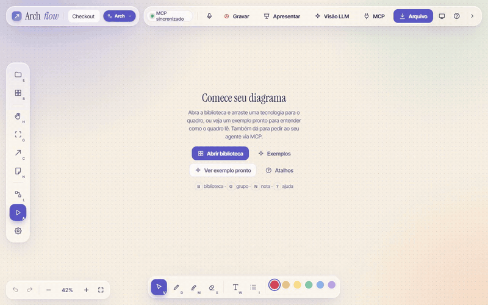
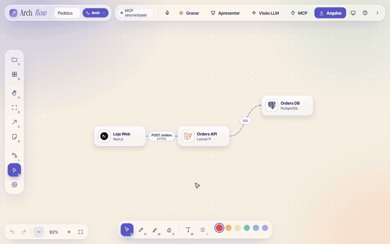
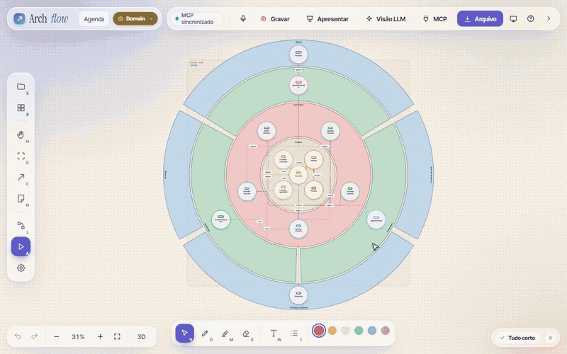
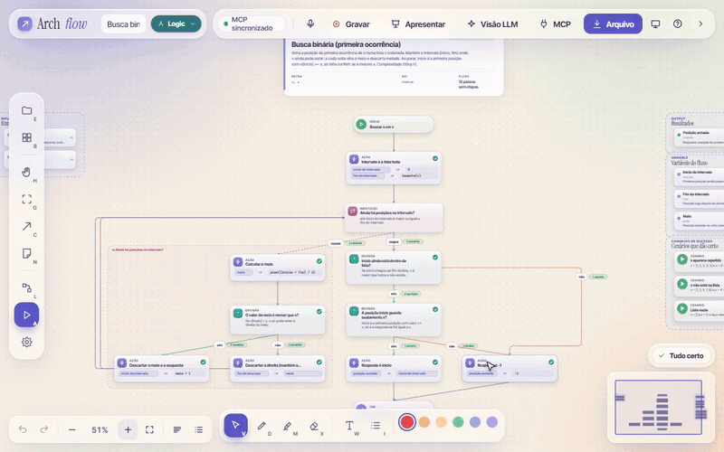
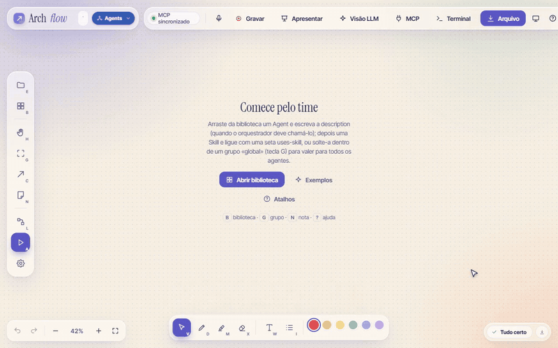
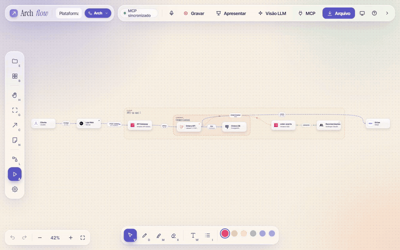

# Archflow

**Quadro branco para software, com MCP.** Você pede, o agente desenha no quadro e você acompanha cada passo.
O Archflow guarda o que cada coisa significa (um serviço é um serviço, uma fila é uma fila, cada conexão tem tipo),
então você e a sua IA leem o mesmo diagrama.

[](https://github.com/joao2end/Archflow/actions/workflows/ci.yml)


**[Abrir no navegador](https://archflow.2-end.online/app)** · **[Baixar](https://github.com/joao2end/Archflow/releases/latest)** · **[Guia completo](docs/GUIA.md)**



## Quatro modos, um quadro

### Arch: arquitetura com significado

Mais de 200 tecnologias na biblioteca, cada uma com o problema que resolve. Conexões síncronas, assíncronas, streaming, de dados e UML, com endpoints e contratos.



### Domain: DDD em camadas, também em 3D

Aggregates, commands e eventos nos anéis da Clean Architecture. A validação aponta o que falta e o app gera o esqueleto em TypeScript.



### Logic: regras de negócio que rodam

O fluxo é executável: cada cenário roda com dados de exemplo e mostra o valor mudando a cada passo. O ✔ só aparece quando o resultado bate.



### Agents: o time de IA vira harness

Subagentes, skills, tools e workflows viram os arquivos que o Claude Code e o Cursor leem. Os workflows rodam no terminal do Claude Code, dentro do app.



### Apresentação

A tecla `P` monta os slides a partir do diagrama: cada passo acende o que importa e conta a história ao lado. Dá para gravar a tela com a sua voz.



## Começar

| Como | O que fazer |
| --- | --- |
| **No navegador** | Abra [archflow.2-end.online/app](https://archflow.2-end.online/app). Os projetos ficam no navegador; não há MCP nem terminal. |
| **App desktop** | Baixe na página de [Releases](https://github.com/joao2end/Archflow/releases/latest): `.exe` (Windows), `.dmg` (macOS) ou `.AppImage` (Linux). Já traz o servidor MCP. |
| **Do código** | Node.js 22+, depois `npm install` e `npm run dev`. O app abre em `http://localhost:5173/app`. |

## Conectar o seu agente

No app, o botão **MCP** instala e testa a conexão no Claude Code, Claude Desktop, Cursor ou Windsurf. Pelo terminal:

```bash
claude mcp add --scope user archflow -- "C:\Program Files\Archflow\Archflow.exe" --mcp
```

No macOS o executável é `/Applications/Archflow.app/Contents/MacOS/Archflow`. Depois peça, por exemplo:
*"Use o archflow para desenhar uma arquitetura de pedidos com Laravel, Postgres e SQS"*.

## Documentação

- [Guia completo](docs/GUIA.md): instalação, cada modo em detalhe, MCP, projetos, atalhos e scripts
- [Protocolo (bridge, MCP e formato dos arquivos)](docs/PROTOCOL.md)
- [DDD do zero](docs/DDD.md) · [Modo Domain](docs/DOMAIN_MODE.md) · [Tutorial do modo Logic](docs/LOGIC_TUTORIAL.md)
- [Exemplos prontos](examples/README.md)

## Estrutura

```
src/shared   modelo, catálogo, operações, layouts e validação (usado pela UI, bridge e MCP)
src/ui       canvas, painéis e modais
src/landing  landing page (/)
server       bridge HTTP/SSE, terminal e servidor MCP
electron     app desktop
docs         documentação, GIFs e o gravador dos vídeos (docs/promo)
examples     exemplos de DDD, lógica e algoritmos
```

## Contribuindo

Veja o [guia de contribuição](CONTRIBUTING.md) e, para vulnerabilidades, o [SECURITY.md](SECURITY.md). Licença [MIT](LICENSE).

Desenvolvido pela **2.end**. Ícones: Iconify *logos* e *simple-icons* (as marcas pertencem aos donos).
