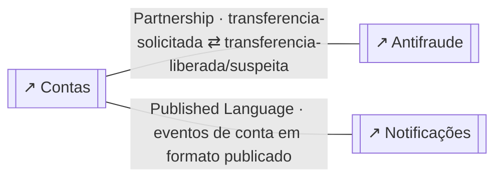
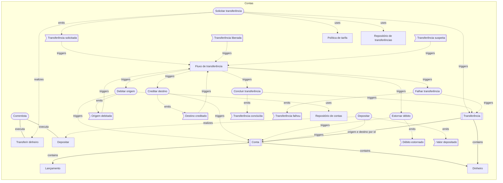
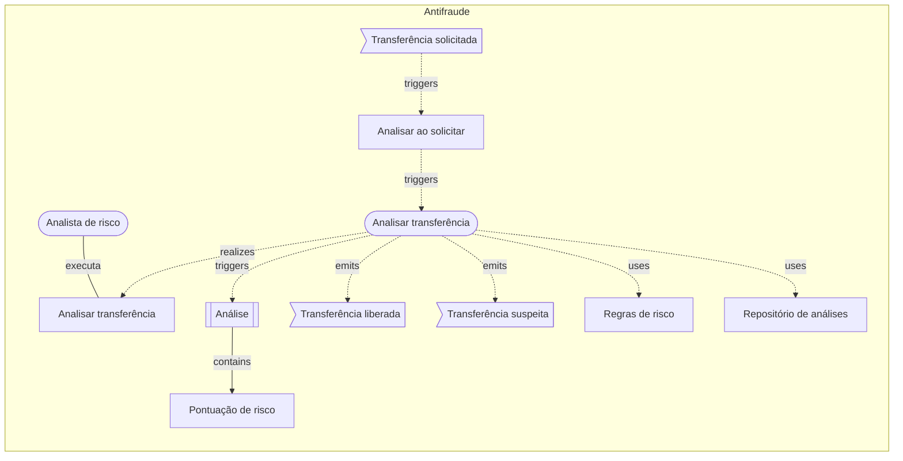
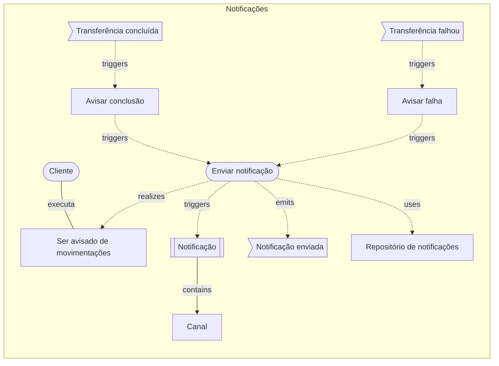

# Banco digital: o modelo em texto

> Gerado a partir dos diagramas desta pasta (`npm run examples:build`); é exatamente o que um agente (MCP) recebe em `get_diagram` e `domain_overview`. Não edite à mão.

# Visão geral do cofre

> 4 diagrama(s) de domínio · 3 contexto(s) · 1 visão(ões) geral(is)

## Mapa de contextos
_exemplos-ddd/banco/visao-geral.archflow.json_
- Contas —partnership→ Antifraude via transferencia-solicitada ⇄ transferencia-liberada/suspeita
- Contas —published-language→ Notificações via eventos de conta em formato publicado

## Contextos
- **Antifraude** `antifraude` (supporting) — `exemplos-ddd/banco/antifraude.archflow.json`
  - aggregates: 1 · commands: 1 · eventos publicados: transferencia-liberada, transferencia-suspeita · consumidos: contas.transferencia-solicitada
- **Contas** `contas` (core) — `exemplos-ddd/banco/contas.archflow.json`
  - aggregates: 2 · commands: 7 · eventos publicados: transferencia-solicitada, origem-debitada, destino-creditado, debito-estornado, transferencia-concluida, transferencia-falhou, valor-depositado · consumidos: antifraude.transferencia-liberada, antifraude.transferencia-suspeita
- **Notificações** `notificacoes` (generic) — `exemplos-ddd/banco/notificacoes.archflow.json`
  - aggregates: 1 · commands: 1 · eventos publicados: notificacao-enviada · consumidos: contas.transferencia-concluida, contas.transferencia-falhou

## Casos de uso
- 4 de 4 rastreados até um evento (100%)
- ✔ `analisar-uc` Analisar transferência (exemplos-ddd/banco/antifraude.archflow.json)
- ✔ `transferir-uc` Transferir dinheiro (exemplos-ddd/banco/contas.archflow.json)
- ✔ `depositar-uc` Depositar (exemplos-ddd/banco/contas.archflow.json)
- ✔ `ser-avisado-uc` Ser avisado de movimentações (exemplos-ddd/banco/notificacoes.archflow.json)

## Avisos
- [D011 dica] contexto `antifraude` (Antifraude) sem ligação com a arquitetura: adicione um componente "system" com ref para o diagrama de arquitetura — `exemplos-ddd/banco/antifraude.archflow.json`
- [D011 dica] contexto `contas` (Contas) sem ligação com a arquitetura: adicione um componente "system" com ref para o diagrama de arquitetura — `exemplos-ddd/banco/contas.archflow.json`
- [D011 dica] contexto `notificacoes` (Notificações) sem ligação com a arquitetura: adicione um componente "system" com ref para o diagrama de arquitetura — `exemplos-ddd/banco/notificacoes.archflow.json`

---

<!-- exemplos-ddd/banco/visao-geral.archflow.json -->
# Visão geral — domínio

Banco digital: mapa de contextos. Dinheiro exige rigor: um aggregate por transação, consistência eventual entre contas e uma saga que desfaz o que já foi feito quando algo falha no meio do caminho.

> schema archflow/1 · modo domain · 0 contexto(s) · 0 aggregate(s) · 0 caso(s) de uso

## Fora de qualquer contexto

## Relações entre contextos
- `contas` —partnership→ `antifraude` via transferencia-solicitada ⇄ transferencia-liberada/suspeita — Dois contextos evoluem juntos e coordenam entregas.
- `contas` —published-language→ `notificacoes` via eventos de conta em formato publicado — Linguagem de troca documentada e compartilhada (ex.: JSON schema, AsyncAPI).

## Diagramas referenciados
- `contas` **Contas** → `exemplos-ddd/banco/contas.archflow.json`
- `antifraude` **Antifraude** → `exemplos-ddd/banco/antifraude.archflow.json`
- `notificacoes` **Notificações** → `exemplos-ddd/banco/notificacoes.archflow.json`

## Mermaid

---

<!-- exemplos-ddd/banco/contas.archflow.json -->
# Contas — domínio

> schema archflow/1 · modo domain · 1 contexto(s) · 2 aggregate(s) · 2 caso(s) de uso

## Contexto `contas` (core) — Contas
Saldo, depósitos, saques e transferências. Errar aqui é perder dinheiro de cliente.
_Diferencial competitivo do negócio; onde vale investir no melhor modelo._

### Aggregate `conta` (root: Conta)
Uma transação de banco mexe em UMA conta. Mover dinheiro entre duas contas são duas transações, coordenadas pela saga.
- entity: `lancamento`
- value-object: `dinheiro`
- invariantes: o saldo nunca fica abaixo de menos o limite; cada lançamento tem valor diferente de zero; uma operação por vez por conta (controle de versão)
- command `debitar-origem` — tirar o valor da conta de origem
- command `creditar-destino` — colocar o valor na conta de destino
- command `estornar-debito` — devolver o valor à origem (compensação)
- command `depositar` — creditar um depósito
- evento `origem-debitada` (payload: transferenciaId, origem, valor)
- evento `destino-creditado` (payload: transferenciaId, destino, valor)
- evento `debito-estornado` (payload: transferenciaId, origem, valor)
- evento `valor-depositado` (payload: contaId, valor)
- repository `conta-repo`

### Aggregate `transferencia` (root: Transferência)
O acompanhamento da transferência é um aggregate próprio: a saga o consulta e o altera, em vez de segurar o estado na memória.
- value-object: `dinheiro`
- invariantes: origem e destino são contas diferentes; valor maior que zero; só vai de solicitada para concluída ou falhou
- command `solicitar-transferencia` — registrar o pedido de transferência
- command `concluir-transferencia` — marcar a transferência como feita
- command `falhar-transferencia` — marcar a transferência como não realizada
- evento `transferencia-solicitada` (payload: transferenciaId, origem, destino, valor)
- evento `transferencia-concluida` (payload: transferenciaId)
- evento `transferencia-falhou` (payload: transferenciaId, motivo)
- repository `transferencia-repo`

### Process managers (sagas)
- `fluxo-de-transferencia` **Fluxo de transferência**: reage a transferencia-solicitada, transferencia-liberada, transferencia-suspeita, origem-debitada, destino-creditado → dispara debitar-origem, creditar-destino, estornar-debito, concluir-transferencia, falhar-transferencia · compensa com estornar-debito

### Domain services
- `politica-de-tarifa` **Política de tarifa** — tarifa de uma transferência conforme o tipo de conta

### Eventos consumidos de outros contextos
- `transferencia-liberada` ← antifraude.transferencia-liberada
- `transferencia-suspeita` ← antifraude.transferencia-suspeita

## Casos de uso e rastreio
- `transferir-uc` Transferir dinheiro (ator: Correntista) → solicitar-transferencia → transferencia → transferencia-solicitada ✔
- `depositar-uc` Depositar (ator: Correntista) → depositar → conta → valor-depositado ✔

## Avisos
- [D011 dica] contexto `contas` (Contas) sem ligação com a arquitetura: adicione um componente "system" com ref para o diagrama de arquitetura

## Mermaid

---

<!-- exemplos-ddd/banco/antifraude.archflow.json -->
# Antifraude — domínio

> schema archflow/1 · modo domain · 1 contexto(s) · 1 aggregate(s) · 1 caso(s) de uso

## Contexto `antifraude` (supporting) — Antifraude
Decide se uma transferência parece legítima. Evolui no ritmo das fraudes, não do produto.
_Necessário ao negócio, mas sem diferencial; costuma ser feito sob medida e simples._

### Aggregate `analise` (root: Análise)
- value-object: `pontuacao-de-risco`
- invariantes: uma transferência tem uma única análise; decisão tomada não muda
- command `analisar-transferencia` — aplicar as regras de risco
- evento `transferencia-liberada` (payload: transferenciaId)
- evento `transferencia-suspeita` (payload: transferenciaId, motivo)
- repository `analise-repo`

### Policies
- `analisar-ao-solicitar` **Analisar ao solicitar** reage a transferencia-solicitada → dispara analisar-transferencia — toda transferência solicitada passa pela análise

### Domain services
- `regras-de-risco` **Regras de risco** — calcula a pontuação a partir do histórico e do valor

### Eventos consumidos de outros contextos
- `transferencia-solicitada` ← contas.transferencia-solicitada

## Casos de uso e rastreio
- `analisar-uc` Analisar transferência (ator: Analista de risco) → analisar-transferencia → analise → transferencia-liberada | analisar-transferencia → analise → transferencia-suspeita ✔

## Avisos
- [D011 dica] contexto `antifraude` (Antifraude) sem ligação com a arquitetura: adicione um componente "system" com ref para o diagrama de arquitetura

## Mermaid

---

<!-- exemplos-ddd/banco/notificacoes.archflow.json -->
# Notificações — domínio

> schema archflow/1 · modo domain · 1 contexto(s) · 1 aggregate(s) · 1 caso(s) de uso

## Contexto `notificacoes` (generic) — Notificações
Avisar o cliente por e-mail ou push. Problema genérico: poderia ser um serviço de mercado.
_Problema comum e resolvido no mercado (auth, e-mail, pagamento); prefira comprar ou usar pronto._

### Aggregate `notificacao` (root: Notificação)
- value-object: `canal`
- invariantes: uma notificação é enviada no máximo uma vez
- command `enviar-notificacao` — mandar a mensagem pelo canal do cliente
- evento `notificacao-enviada` (payload: notificacaoId, canal)
- repository `notificacao-repo`

### Policies
- `avisar-conclusao` **Avisar conclusão** reage a transferencia-concluida → dispara enviar-notificacao — transferência concluída gera aviso
- `avisar-falha` **Avisar falha** reage a transferencia-falhou → dispara enviar-notificacao — transferência que falhou gera aviso

### Eventos consumidos de outros contextos
- `transferencia-concluida` ← contas.transferencia-concluida
- `transferencia-falhou` ← contas.transferencia-falhou

## Casos de uso e rastreio
- `ser-avisado-uc` Ser avisado de movimentações (ator: Cliente) → enviar-notificacao → notificacao → notificacao-enviada ✔

## Avisos
- [D011 dica] contexto `notificacoes` (Notificações) sem ligação com a arquitetura: adicione um componente "system" com ref para o diagrama de arquitetura

## Mermaid

