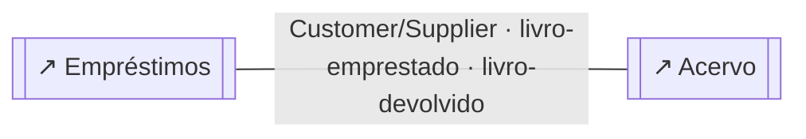
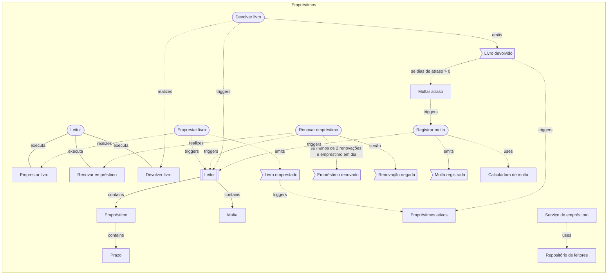
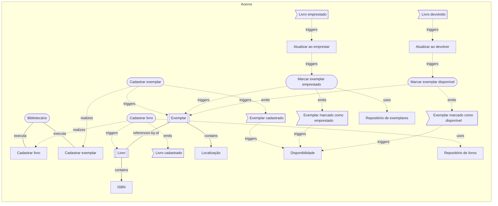

# Biblioteca universitária: o modelo em texto

> Gerado a partir dos diagramas desta pasta (`npm run examples:build`); é exatamente o que um agente (MCP) recebe em `get_diagram` e `domain_overview`. Não edite à mão.

# Visão geral do projeto

> 3 diagrama(s) de domínio · 2 contexto(s) · 1 visão(ões) geral(is)

## Mapa de contextos
_exemplos-ddd/biblioteca/visao-geral.archflow.json_
- Empréstimos —customer-supplier→ Acervo via livro-emprestado · livro-devolvido

## Contextos
- **Acervo** `acervo` (supporting) — `exemplos-ddd/biblioteca/acervo.archflow.json`
  - aggregates: 2 · commands: 4 · eventos publicados: livro-cadastrado, exemplar-cadastrado, exemplar-emprestado, exemplar-disponivel · consumidos: emprestimos.livro-emprestado, emprestimos.livro-devolvido
- **Empréstimos** `emprestimos` (core) — `exemplos-ddd/biblioteca/emprestimos.archflow.json`
  - aggregates: 1 · commands: 4 · eventos publicados: livro-emprestado, emprestimo-renovado, renovacao-negada, livro-devolvido, multa-registrada · consumidos: —

## Casos de uso
- 5 de 5 rastreados até um evento (100%)
- ✔ `cadastrar-livro-uc` Cadastrar livro (exemplos-ddd/biblioteca/acervo.archflow.json)
- ✔ `cadastrar-exemplar-uc` Cadastrar exemplar (exemplos-ddd/biblioteca/acervo.archflow.json)
- ✔ `emprestar-livro-uc` Emprestar livro (exemplos-ddd/biblioteca/emprestimos.archflow.json)
- ✔ `renovar-uc` Renovar empréstimo (exemplos-ddd/biblioteca/emprestimos.archflow.json)
- ✔ `devolver-uc` Devolver livro (exemplos-ddd/biblioteca/emprestimos.archflow.json)

## Avisos
- [D011 dica] contexto `acervo` (Acervo) sem ligação com a arquitetura: adicione um componente "system" com ref para o diagrama de arquitetura — `exemplos-ddd/biblioteca/acervo.archflow.json`
- [D035 dica] `cadastrar-livro` (Cadastrar livro) depende de `livro-repo` (Repositório de livros) por uma porta implícita: declare a porta na conexão (port, ex.: "RepositorioLivros") para o diagrama mostrar a interface que a camada de dentro define — `exemplos-ddd/biblioteca/acervo.archflow.json`
- [D035 dica] `marcar-emprestado` (Marcar exemplar emprestado) depende de `exemplar-repo` (Repositório de exemplares) por uma porta implícita: declare a porta na conexão (port, ex.: "RepositorioExemplares") para o diagrama mostrar a interface que a camada de dentro define — `exemplos-ddd/biblioteca/acervo.archflow.json`
- [D011 dica] contexto `emprestimos` (Empréstimos) sem ligação com a arquitetura: adicione um componente "system" com ref para o diagrama de arquitetura — `exemplos-ddd/biblioteca/emprestimos.archflow.json`
- [D035 dica] `servico-de-emprestimo` (Serviço de empréstimo) depende de `leitor-repo` (Repositório de leitores) por uma porta implícita: declare a porta na conexão (port, ex.: "RepositorioLeitores") para o diagrama mostrar a interface que a camada de dentro define — `exemplos-ddd/biblioteca/emprestimos.archflow.json`

---

<!-- exemplos-ddd/biblioteca/visao-geral.archflow.json -->
# Visão geral — domínio

Biblioteca universitária: mapa de contextos. O exemplo mais simples: duas áreas do negócio, um aggregate bem delimitado pelas suas invariantes e um evento atravessando de um contexto para o outro.

> schema archflow/1 · modo domain · 0 contexto(s) · 0 aggregate(s) · 0 caso(s) de uso

## Fora de qualquer contexto

## Relações entre contextos
- `emprestimos` —customer-supplier→ `acervo` via livro-emprestado · livro-devolvido — Fornecedor (upstream) atende o cliente (downstream), que influencia o plano.

## Diagramas referenciados
- `emprestimos` **Empréstimos** → `exemplos-ddd/biblioteca/emprestimos.archflow.json`
- `acervo` **Acervo** → `exemplos-ddd/biblioteca/acervo.archflow.json`

## Mermaid

---

<!-- exemplos-ddd/biblioteca/emprestimos.archflow.json -->
# Empréstimos — domínio

> schema archflow/1 · modo domain · 1 contexto(s) · 1 aggregate(s) · 3 caso(s) de uso

## Contexto `emprestimos` (core) — Empréstimos
Quem pode levar o quê, por quanto tempo e o que acontece quando atrasa. É o coração do negócio da biblioteca.
_Diferencial competitivo do negócio; onde vale investir no melhor modelo._

### Aggregate `leitor` (root: Leitor)
O Leitor é o aggregate porque as regras acima precisam ser garantidas juntas, na mesma transação: por isso os empréstimos e as multas moram dentro dele.
- entity: `emprestimo`, `multa`
- value-object: `prazo`
- invariantes: no máximo 3 empréstimos ativos; leitor com multa em aberto não pode emprestar; empréstimo devolvido não pode ser renovado; no máximo 2 renovações por empréstimo
- command `emprestar-livro` — abrir um empréstimo de um exemplar para o leitor
- command `renovar-emprestimo` — estender o prazo de um empréstimo ativo
- command `devolver-livro` — encerrar o empréstimo e liberar o exemplar
- command `registrar-multa` — cobrar o atraso na devolução
- evento `livro-emprestado` (payload: leitorId, exemplarId, prazo)
- evento `emprestimo-renovado` (payload: leitorId, exemplarId, prazo)
- evento `renovacao-negada` (payload: leitorId, exemplarId, motivo)
- evento `livro-devolvido` (payload: leitorId, exemplarId, diasDeAtraso)
- evento `multa-registrada` (payload: leitorId, valor)
- repository `leitor-repo`

### Policies
- `multar-atraso` **Multar atraso** reage a livro-devolvido → dispara registrar-multa — se o livro volta depois do prazo, registra a multa

### Domain services
- `calculadora-de-multa` **Calculadora de multa** — valor da multa a partir dos dias de atraso

### Application services
- `servico-de-emprestimo` **Serviço de empréstimo** — carrega o Leitor, aplica o command, grava e publica os eventos

### Read models
- `emprestimos-ativos` **Empréstimos ativos** projeta livro-emprestado, livro-devolvido

## Casos de uso e rastreio
- `emprestar-livro-uc` Emprestar livro (ator: Leitor) → emprestar-livro → leitor → livro-emprestado ✔
- `renovar-uc` Renovar empréstimo (ator: Leitor) → renovar-emprestimo → leitor → emprestimo-renovado | renovar-emprestimo → leitor → renovacao-negada ✔
- `devolver-uc` Devolver livro (ator: Leitor) → devolver-livro → leitor → livro-devolvido ✔

## Fluxo condicional, loops e iterações
- `renovar-emprestimo` —[se menos de 2 renovações e empréstimo em dia]→ `emprestimo-renovado`
- `renovar-emprestimo` —[senão]→ `renovacao-negada`
- `livro-devolvido` —[se dias de atraso > 0]→ `multar-atraso`

## Avisos
- [D011 dica] contexto `emprestimos` (Empréstimos) sem ligação com a arquitetura: adicione um componente "system" com ref para o diagrama de arquitetura
- [D035 dica] `servico-de-emprestimo` (Serviço de empréstimo) depende de `leitor-repo` (Repositório de leitores) por uma porta implícita: declare a porta na conexão (port, ex.: "RepositorioLeitores") para o diagrama mostrar a interface que a camada de dentro define

## Mermaid

---

<!-- exemplos-ddd/biblioteca/acervo.archflow.json -->
# Acervo — domínio

> schema archflow/1 · modo domain · 1 contexto(s) · 2 aggregate(s) · 2 caso(s) de uso

## Contexto `acervo` (supporting) — Acervo
O catálogo: quais livros existem e onde estão os exemplares. Necessário, mas não é o diferencial da biblioteca.
_Necessário ao negócio, mas sem diferencial; costuma ser feito sob medida e simples._

### Aggregate `livro` (root: Livro)
- value-object: `isbn`
- invariantes: o ISBN é único no catálogo
- command `cadastrar-livro` — incluir um título no catálogo
- evento `livro-cadastrado` (payload: livroId, isbn)
- repository `livro-repo`

### Aggregate `exemplar` (root: Exemplar)
Um exemplar muda de estado por conta própria; por isso é um aggregate separado do Livro e o referencia só pelo id.
- value-object: `localizacao`
- invariantes: um exemplar está disponível ou emprestado, nunca os dois
- command `cadastrar-exemplar` — registrar uma cópia física
- command `marcar-emprestado` — o exemplar saiu da estante
- command `marcar-disponivel` — o exemplar voltou para a estante
- evento `exemplar-cadastrado` (payload: exemplarId, livroId)
- evento `exemplar-emprestado` (payload: exemplarId)
- evento `exemplar-disponivel` (payload: exemplarId)
- repository `exemplar-repo`

### Policies
- `atualizar-ao-emprestar` **Atualizar ao emprestar** reage a livro-emprestado-ext → dispara marcar-emprestado — quando um livro é emprestado, o exemplar sai do acervo
- `atualizar-ao-devolver` **Atualizar ao devolver** reage a livro-devolvido-ext → dispara marcar-disponivel — quando um livro volta, o exemplar fica disponível

### Read models
- `disponibilidade` **Disponibilidade** projeta exemplar-cadastrado, exemplar-emprestado, exemplar-disponivel

### Eventos consumidos de outros contextos
- `livro-emprestado-ext` ← emprestimos.livro-emprestado
- `livro-devolvido-ext` ← emprestimos.livro-devolvido

## Casos de uso e rastreio
- `cadastrar-livro-uc` Cadastrar livro (ator: Bibliotecário) → cadastrar-livro → livro → livro-cadastrado ✔
- `cadastrar-exemplar-uc` Cadastrar exemplar (ator: Bibliotecário) → cadastrar-exemplar → exemplar → exemplar-cadastrado ✔

## Avisos
- [D011 dica] contexto `acervo` (Acervo) sem ligação com a arquitetura: adicione um componente "system" com ref para o diagrama de arquitetura
- [D035 dica] `cadastrar-livro` (Cadastrar livro) depende de `livro-repo` (Repositório de livros) por uma porta implícita: declare a porta na conexão (port, ex.: "RepositorioLivros") para o diagrama mostrar a interface que a camada de dentro define
- [D035 dica] `marcar-emprestado` (Marcar exemplar emprestado) depende de `exemplar-repo` (Repositório de exemplares) por uma porta implícita: declare a porta na conexão (port, ex.: "RepositorioExemplares") para o diagrama mostrar a interface que a camada de dentro define

## Mermaid

