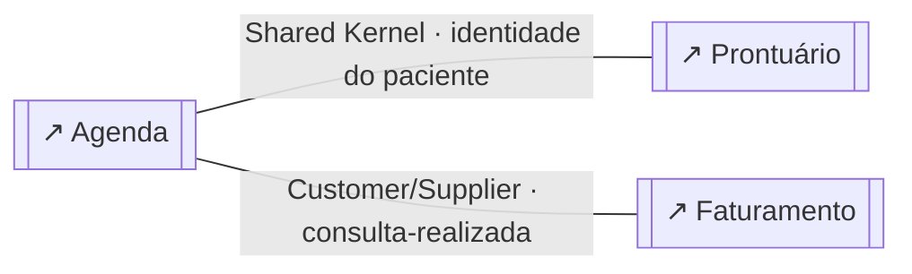
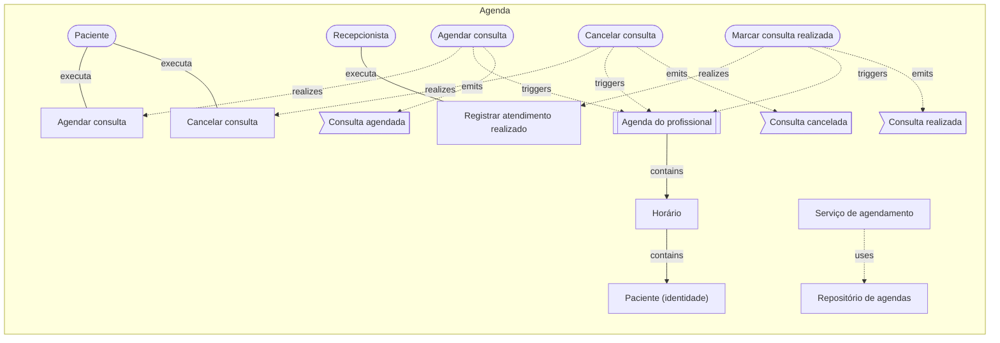
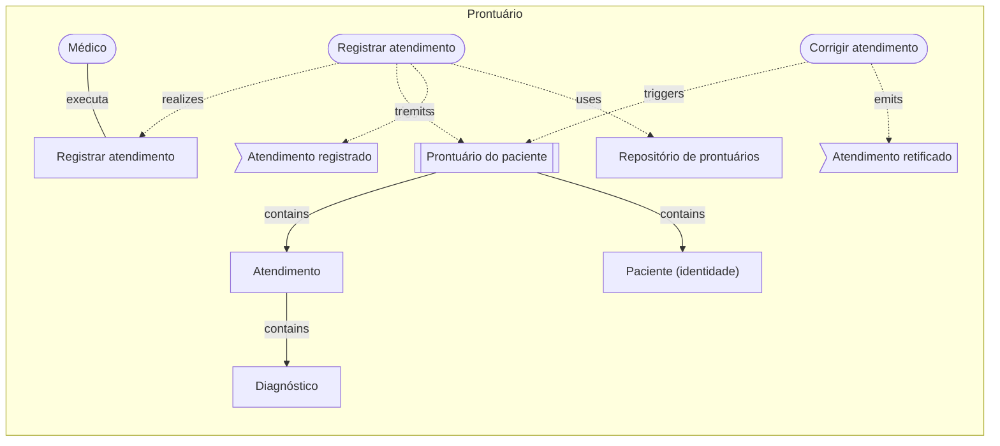
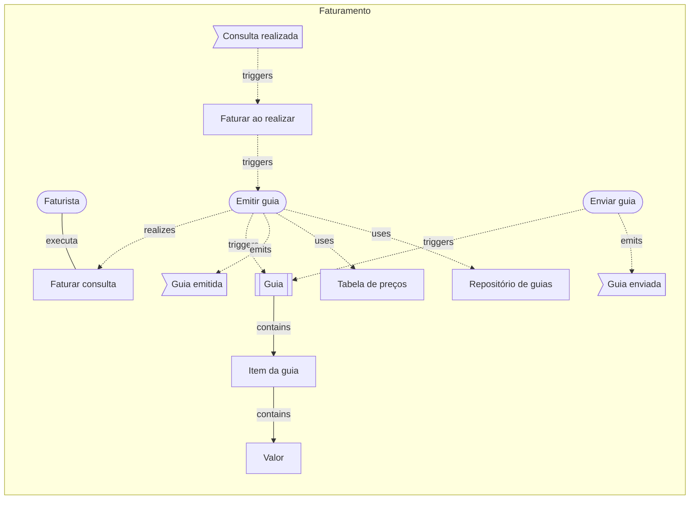

# Clínica médica: o modelo em texto

> Gerado a partir dos diagramas desta pasta (`npm run examples:build`); é exatamente o que um agente (MCP) recebe em `get_diagram` e `domain_overview`. Não edite à mão.

# Visão geral do cofre

> 4 diagrama(s) de domínio · 3 contexto(s) · 1 visão(ões) geral(is)

## Mapa de contextos
_exemplos-ddd/clinica/visao-geral.archflow.json_
- Agenda —shared-kernel→ Prontuário via identidade do paciente
- Agenda —customer-supplier→ Faturamento via consulta-realizada

## Contextos
- **Agenda** `agenda` (core) — `exemplos-ddd/clinica/agenda.archflow.json`
  - aggregates: 1 · commands: 3 · eventos publicados: consulta-agendada, consulta-cancelada, consulta-realizada · consumidos: —
- **Faturamento** `faturamento` (supporting) — `exemplos-ddd/clinica/faturamento.archflow.json`
  - aggregates: 1 · commands: 2 · eventos publicados: guia-emitida, guia-enviada · consumidos: agenda.consulta-realizada
- **Prontuário** `prontuario` (core) — `exemplos-ddd/clinica/prontuario.archflow.json`
  - aggregates: 1 · commands: 2 · eventos publicados: atendimento-registrado, atendimento-retificado · consumidos: —

## Casos de uso
- 5 de 5 rastreados até um evento (100%)
- ✔ `agendar-uc` Agendar consulta (exemplos-ddd/clinica/agenda.archflow.json)
- ✔ `cancelar-uc` Cancelar consulta (exemplos-ddd/clinica/agenda.archflow.json)
- ✔ `realizar-uc` Registrar atendimento realizado (exemplos-ddd/clinica/agenda.archflow.json)
- ✔ `faturar-uc` Faturar consulta (exemplos-ddd/clinica/faturamento.archflow.json)
- ✔ `registrar-uc` Registrar atendimento (exemplos-ddd/clinica/prontuario.archflow.json)

## Avisos
- [D011 dica] contexto `agenda` (Agenda) sem ligação com a arquitetura: adicione um componente "system" com ref para o diagrama de arquitetura — `exemplos-ddd/clinica/agenda.archflow.json`
- [D011 dica] contexto `faturamento` (Faturamento) sem ligação com a arquitetura: adicione um componente "system" com ref para o diagrama de arquitetura — `exemplos-ddd/clinica/faturamento.archflow.json`
- [D011 dica] contexto `prontuario` (Prontuário) sem ligação com a arquitetura: adicione um componente "system" com ref para o diagrama de arquitetura — `exemplos-ddd/clinica/prontuario.archflow.json`

---

<!-- exemplos-ddd/clinica/visao-geral.archflow.json -->
# Visão geral — domínio

Clínica médica: mapa de contextos. Onde traçar a fronteira do aggregate (a agenda, não a consulta), vocabulários diferentes para a mesma pessoa em cada contexto e um Shared Kernel assumido de propósito.

> schema archflow/1 · modo domain · 0 contexto(s) · 0 aggregate(s) · 0 caso(s) de uso

## Fora de qualquer contexto

## Relações entre contextos
- `agenda` —shared-kernel→ `prontuario` via identidade do paciente — Os contextos compartilham um subconjunto do modelo e mudam juntos.
- `agenda` —customer-supplier→ `faturamento` via consulta-realizada — Fornecedor (upstream) atende o cliente (downstream), que influencia o plano.

## Diagramas referenciados
- `agenda` **Agenda** → `exemplos-ddd/clinica/agenda.archflow.json`
- `prontuario` **Prontuário** → `exemplos-ddd/clinica/prontuario.archflow.json`
- `faturamento` **Faturamento** → `exemplos-ddd/clinica/faturamento.archflow.json`

## Mermaid

---

<!-- exemplos-ddd/clinica/agenda.archflow.json -->
# Agenda — domínio

> schema archflow/1 · modo domain · 1 contexto(s) · 1 aggregate(s) · 3 caso(s) de uso

## Contexto `agenda` (core) — Agenda
Quando cada profissional atende quem. Evitar horário duplicado é a regra que mais pesa.
_Diferencial competitivo do negócio; onde vale investir no melhor modelo._

### Aggregate `agenda-do-profissional` (root: Agenda do profissional)
O aggregate é a agenda inteira de um profissional, não a consulta isolada: a regra "sem sobreposição" só pode ser garantida olhando todos os horários juntos.
- entity: `horario`
- value-object: `paciente`
- invariantes: dois horários de um profissional não se sobrepõem; consulta realizada não pode ser cancelada
- command `agendar-consulta` — reservar um horário livre da agenda
- command `cancelar-consulta` — liberar o horário reservado
- command `marcar-consulta-realizada` — a consulta aconteceu
- evento `consulta-agendada` (payload: agendaId, horarioId, pacienteId)
- evento `consulta-cancelada` (payload: agendaId, horarioId)
- evento `consulta-realizada` (payload: agendaId, horarioId, pacienteId, procedimento)
- repository `agenda-repo`

### Application services
- `servico-de-agendamento` **Serviço de agendamento** — carrega a agenda, aplica o command e publica os eventos

## Casos de uso e rastreio
- `agendar-uc` Agendar consulta (ator: Paciente) → agendar-consulta → agenda-do-profissional → consulta-agendada ✔
- `cancelar-uc` Cancelar consulta (ator: Paciente) → cancelar-consulta → agenda-do-profissional → consulta-cancelada ✔
- `realizar-uc` Registrar atendimento realizado (ator: Recepcionista) → marcar-consulta-realizada → agenda-do-profissional → consulta-realizada ✔

## Avisos
- [D011 dica] contexto `agenda` (Agenda) sem ligação com a arquitetura: adicione um componente "system" com ref para o diagrama de arquitetura

## Mermaid

---

<!-- exemplos-ddd/clinica/prontuario.archflow.json -->
# Prontuário — domínio

> schema archflow/1 · modo domain · 1 contexto(s) · 1 aggregate(s) · 1 caso(s) de uso

## Contexto `prontuario` (core) — Prontuário
O histórico clínico do paciente. Sigiloso, auditável e com vocabulário próprio da medicina.
_Diferencial competitivo do negócio; onde vale investir no melhor modelo._

### Aggregate `prontuario-do-paciente` (root: Prontuário do paciente)
- entity: `atendimento`
- value-object: `diagnostico`, `paciente`
- invariantes: registro assinado nunca é apagado, só retificado; todo atendimento tem profissional e data
- command `registrar-atendimento` — incluir um atendimento no prontuário
- command `corrigir-atendimento` — retificar um registro (sem apagar o original)
- evento `atendimento-registrado` (payload: prontuarioId, atendimentoId)
- evento `atendimento-retificado` (payload: prontuarioId, atendimentoId)
- repository `prontuario-repo`

## Casos de uso e rastreio
- `registrar-uc` Registrar atendimento (ator: Médico) → registrar-atendimento → prontuario-do-paciente → atendimento-registrado ✔

## Avisos
- [D011 dica] contexto `prontuario` (Prontuário) sem ligação com a arquitetura: adicione um componente "system" com ref para o diagrama de arquitetura

## Mermaid

---

<!-- exemplos-ddd/clinica/faturamento.archflow.json -->
# Faturamento — domínio

> schema archflow/1 · modo domain · 1 contexto(s) · 1 aggregate(s) · 1 caso(s) de uso

## Contexto `faturamento` (supporting) — Faturamento
Cobrar do convênio ou do paciente o que foi atendido. Linguagem de contabilidade, não de clínica.
_Necessário ao negócio, mas sem diferencial; costuma ser feito sob medida e simples._

### Aggregate `guia` (root: Guia)
- entity: `item-da-guia`
- value-object: `valor`
- invariantes: valor vem da tabela do convênio na data do atendimento; guia enviada não pode ser alterada
- command `emitir-guia` — gerar a guia de cobrança do procedimento
- command `enviar-guia` — mandar a guia ao convênio
- evento `guia-emitida` (payload: guiaId, consultaId, valor)
- evento `guia-enviada` (payload: guiaId, convenio)
- repository `guia-repo`

### Policies
- `faturar-ao-realizar` **Faturar ao realizar** reage a consulta-realizada → dispara emitir-guia — toda consulta realizada gera uma guia

### Domain services
- `tabela-de-precos` **Tabela de preços** — preço de um procedimento conforme o convênio e a data

### Eventos consumidos de outros contextos
- `consulta-realizada` ← agenda.consulta-realizada

## Casos de uso e rastreio
- `faturar-uc` Faturar consulta (ator: Faturista) → emitir-guia → guia → guia-emitida ✔

## Avisos
- [D011 dica] contexto `faturamento` (Faturamento) sem ligação com a arquitetura: adicione um componente "system" com ref para o diagrama de arquitetura

## Mermaid

