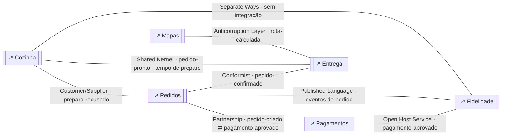
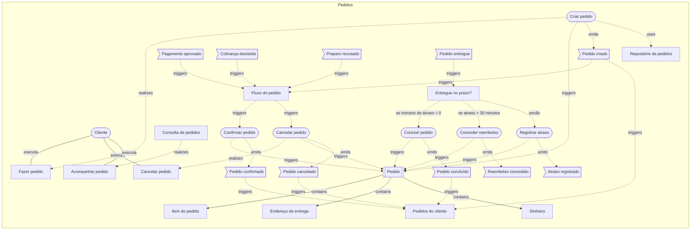
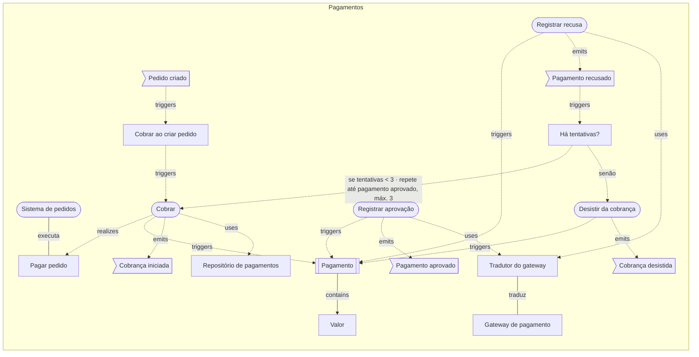
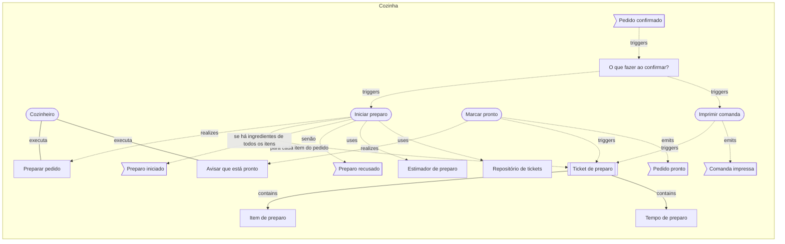
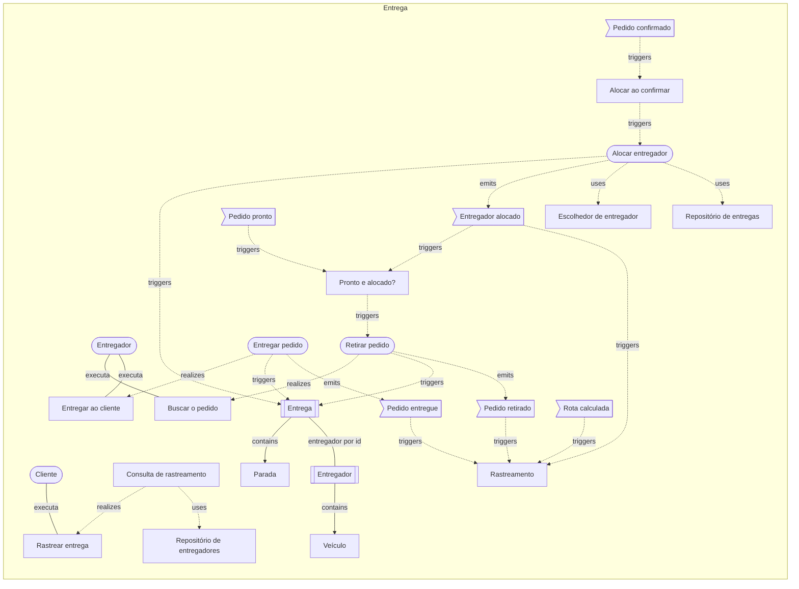
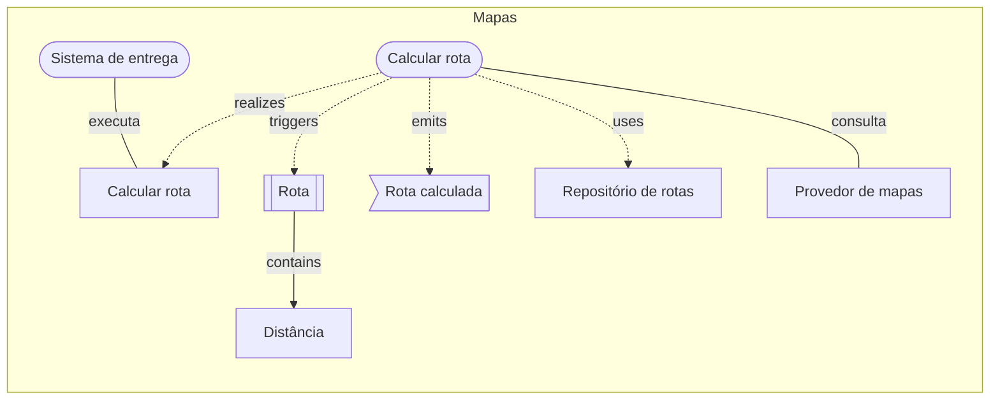
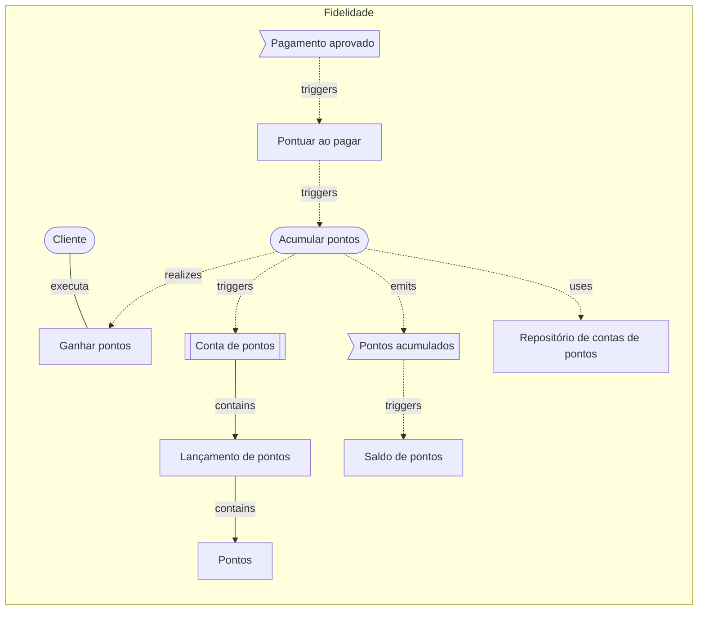

# Delivery de comida (tour completo): o modelo em texto

> Gerado a partir dos diagramas desta pasta (`npm run examples:build`); é exatamente o que um agente (MCP) recebe em `get_diagram` e `domain_overview`. Não edite à mão.

# Visão geral do cofre

> 7 diagrama(s) de domínio · 6 contexto(s) · 1 visão(ões) geral(is)

## Mapa de contextos
_exemplos-ddd/delivery/visao-geral.archflow.json_
- Pedidos —partnership→ Pagamentos via pedido-criado ⇄ pagamento-aprovado
- Cozinha —customer-supplier→ Pedidos via preparo-recusado
- Pedidos —conformist→ Entrega via pedido-confirmado
- Cozinha —shared-kernel→ Entrega via pedido-pronto · tempo de preparo
- Mapas —acl→ Entrega via rota-calculada
- Pagamentos —ohs→ Fidelidade via pagamento-aprovado
- Pedidos —published-language→ Fidelidade via eventos de pedido
- Cozinha —separate-ways→ Fidelidade via sem integração

## Contextos
- **Cozinha** `cozinha` (core) — `exemplos-ddd/delivery/cozinha.archflow.json`
  - aggregates: 1 · commands: 3 · eventos publicados: preparo-iniciado, preparo-recusado, comanda-impressa, pedido-pronto · consumidos: pedidos.pedido-confirmado
- **Entrega** `entrega` (core) — `exemplos-ddd/delivery/entrega.archflow.json`
  - aggregates: 2 · commands: 3 · eventos publicados: entregador-alocado, pedido-retirado, pedido-entregue · consumidos: pedidos.pedido-confirmado, cozinha.pedido-pronto, mapas.rota-calculada
- **Fidelidade** `fidelidade` (supporting) — `exemplos-ddd/delivery/fidelidade.archflow.json`
  - aggregates: 1 · commands: 1 · eventos publicados: pontos-acumulados · consumidos: pagamentos.pagamento-aprovado
- **Mapas** `mapas` (generic) — `exemplos-ddd/delivery/mapas.archflow.json`
  - aggregates: 1 · commands: 1 · eventos publicados: rota-calculada · consumidos: —
- **Pagamentos** `pagamentos` (generic) — `exemplos-ddd/delivery/pagamentos.archflow.json`
  - aggregates: 1 · commands: 4 · eventos publicados: cobranca-iniciada, pagamento-aprovado, pagamento-recusado, cobranca-desistida · consumidos: pedidos.pedido-criado
- **Pedidos** `pedidos` (core) — `exemplos-ddd/delivery/pedidos.archflow.json`
  - aggregates: 1 · commands: 6 · eventos publicados: pedido-criado, pedido-confirmado, pedido-cancelado, pedido-concluido, reembolso-concedido, atraso-registrado · consumidos: pagamentos.pagamento-aprovado, pagamentos.cobranca-desistida, cozinha.preparo-recusado, entrega.pedido-entregue

## Casos de uso
- 11 de 11 rastreados até um evento (100%)
- ✔ `preparar-uc` Preparar pedido (exemplos-ddd/delivery/cozinha.archflow.json)
- ✔ `avisar-pronto-uc` Avisar que está pronto (exemplos-ddd/delivery/cozinha.archflow.json)
- ✔ `buscar-pedido-uc` Buscar o pedido (exemplos-ddd/delivery/entrega.archflow.json)
- ✔ `entregar-uc` Entregar ao cliente (exemplos-ddd/delivery/entrega.archflow.json)
- ✔ `rastrear-uc` Rastrear entrega (exemplos-ddd/delivery/entrega.archflow.json)
- ✔ `ganhar-pontos-uc` Ganhar pontos (exemplos-ddd/delivery/fidelidade.archflow.json)
- ✔ `calcular-rota-uc` Calcular rota (exemplos-ddd/delivery/mapas.archflow.json)
- ✔ `pagar-pedido-uc` Pagar pedido (exemplos-ddd/delivery/pagamentos.archflow.json)
- ✔ `fazer-pedido-uc` Fazer pedido (exemplos-ddd/delivery/pedidos.archflow.json)
- ✔ `cancelar-pedido-uc` Cancelar pedido (exemplos-ddd/delivery/pedidos.archflow.json)
- ✔ `acompanhar-uc` Acompanhar pedido (exemplos-ddd/delivery/pedidos.archflow.json)

## Avisos
- [D011 dica] contexto `cozinha` (Cozinha) sem ligação com a arquitetura: adicione um componente "system" com ref para o diagrama de arquitetura — `exemplos-ddd/delivery/cozinha.archflow.json`
- [D011 dica] contexto `entrega` (Entrega) sem ligação com a arquitetura: adicione um componente "system" com ref para o diagrama de arquitetura — `exemplos-ddd/delivery/entrega.archflow.json`
- [D011 dica] contexto `fidelidade` (Fidelidade) sem ligação com a arquitetura: adicione um componente "system" com ref para o diagrama de arquitetura — `exemplos-ddd/delivery/fidelidade.archflow.json`
- [D011 dica] contexto `mapas` (Mapas) sem ligação com a arquitetura: adicione um componente "system" com ref para o diagrama de arquitetura — `exemplos-ddd/delivery/mapas.archflow.json`
- [D011 dica] contexto `pagamentos` (Pagamentos) sem ligação com a arquitetura: adicione um componente "system" com ref para o diagrama de arquitetura — `exemplos-ddd/delivery/pagamentos.archflow.json`
- [D030 dica] `ha-tentativas` (Há tentativas?) → `cobrar` (Cobrar) está marcada como loop, mas o diagrama não mostra o caminho de volta (de cobrar até ha-tentativas); se o retorno passa por um sistema externo está certo, senão revise a conexão — `exemplos-ddd/delivery/pagamentos.archflow.json`
- [D011 dica] contexto `pedidos` (Pedidos) sem ligação com a arquitetura: adicione um componente "system" com ref para o diagrama de arquitetura — `exemplos-ddd/delivery/pedidos.archflow.json`

---

<!-- exemplos-ddd/delivery/visao-geral.archflow.json -->
# Visão geral — domínio

Delivery de comida (tour completo): mapa de contextos. O exemplo que usa todos os recursos do modo Domain: seis contextos com os oito padrões do Context Map, saga com compensação, policy com ramos condicionais e em paralelo, saga que espera dois eventos, loop, "para cada", propriedades, eventos entre contextos, read models e anotações.

> schema archflow/1 · modo domain · 0 contexto(s) · 0 aggregate(s) · 0 caso(s) de uso

## Fora de qualquer contexto

## Relações entre contextos
- `pedidos` —partnership→ `pagamentos` via pedido-criado ⇄ pagamento-aprovado — Dois contextos evoluem juntos e coordenam entregas.
- `cozinha` —customer-supplier→ `pedidos` via preparo-recusado — Fornecedor (upstream) atende o cliente (downstream), que influencia o plano.
- `pedidos` —conformist→ `entrega` via pedido-confirmado — O downstream adota o modelo do upstream sem negociar.
- `cozinha` —shared-kernel→ `entrega` via pedido-pronto · tempo de preparo — Os contextos compartilham um subconjunto do modelo e mudam juntos.
- `mapas` —acl→ `entrega` via rota-calculada — O downstream traduz o modelo do upstream para proteger o próprio.
- `pagamentos` —ohs→ `fidelidade` via pagamento-aprovado — O upstream expõe um serviço aberto e estável para vários consumidores.
- `pedidos` —published-language→ `fidelidade` via eventos de pedido — Linguagem de troca documentada e compartilhada (ex.: JSON schema, AsyncAPI).
- `cozinha` —separate-ways→ `fidelidade` via sem integração — Sem integração: cada contexto resolve sozinho.

## Diagramas referenciados
- `pedidos` **Pedidos** → `exemplos-ddd/delivery/pedidos.archflow.json`
- `pagamentos` **Pagamentos** → `exemplos-ddd/delivery/pagamentos.archflow.json`
- `cozinha` **Cozinha** → `exemplos-ddd/delivery/cozinha.archflow.json`
- `entrega` **Entrega** → `exemplos-ddd/delivery/entrega.archflow.json`
- `mapas` **Mapas** → `exemplos-ddd/delivery/mapas.archflow.json`
- `fidelidade` **Fidelidade** → `exemplos-ddd/delivery/fidelidade.archflow.json`

## Notas
- partnership: evoluem juntos customer-supplier: o fornecedor atende o cliente conformist: o cliente aceita o modelo do fornecedor shared-kernel: núcleo compartilhado acl: o cliente traduz o modelo de fora ohs: serviço aberto para vários published-language: linguagem documentada separate-ways: sem integração

## Mermaid

---

<!-- exemplos-ddd/delivery/pedidos.archflow.json -->
# Pedidos — domínio

> schema archflow/1 · modo domain · 1 contexto(s) · 1 aggregate(s) · 3 caso(s) de uso

## Contexto `pedidos` (core) — Pedidos
O que o cliente pediu e em que estado está o pedido. A experiência de pedir é o diferencial do negócio.
_Diferencial competitivo do negócio; onde vale investir no melhor modelo._

### Aggregate `pedido` (root: Pedido)
O aggregate protege as regras do pedido inteiro: itens, total e estado mudam juntos, numa só transação.
- entity: `item-do-pedido`
- value-object: `endereco-de-entrega`, `dinheiro`
- invariantes: o total é a soma dos itens; pedido confirmado não aceita novos itens; pedido cancelado não volta a ser confirmado; todo item é do mesmo restaurante
- propriedades de `pedido`: id: uuid #, clienteId: uuid, status: texto, total: Dinheiro, promessaDeEntrega: data e hora, motivoCancelamento?: texto
- propriedades de `item-do-pedido`: produtoId: uuid #, quantidade: inteiro, precoUnitario: Dinheiro, observacao?: texto
- propriedades de `endereco-de-entrega`: logradouro: texto, numero: texto, complemento?: texto, cep: texto
- propriedades de `dinheiro`: valor: inteiro, moeda: texto
- command `criar-pedido` — registrar o pedido com os itens e o endereço (parâmetros: clienteId: uuid, restauranteId: uuid, itens: Item do pedido[], endereco: Endereço de entrega)
- command `confirmar-pedido` — o pagamento foi aprovado: libera o restaurante e a entrega
- command `cancelar-pedido` — encerrar o pedido (cliente desistiu ou algo falhou)
- command `concluir-pedido` — a entrega chegou no prazo
- command `conceder-reembolso` — devolver o valor quando o atraso é grave
- command `registrar-atraso` — anotar a entrega fora do prazo
- evento `pedido-criado` (payload: pedidoId: uuid #, total: Dinheiro)
- evento `pedido-confirmado` (payload: pedidoId, restauranteId, endereco, itens)
- evento `pedido-cancelado` (payload: pedidoId, motivo)
- evento `pedido-concluido` (payload: pedidoId)
- evento `reembolso-concedido` (payload: pedidoId, valor)
- evento `atraso-registrado` (payload: pedidoId, minutosDeAtraso)
- repository `pedido-repo`

### Policies
- `entregue-no-prazo` **Entregue no prazo?** — a entrega chegou no prazo? Se atrasou muito, reembolsa; senão registra o atraso → se minutos de atraso = 0: `concluir-pedido`; se atraso > 30 minutos: `conceder-reembolso`; senão: `registrar-atraso`

### Process managers (sagas)
- `fluxo-do-pedido` **Fluxo do pedido**: reage a pedido-criado, pagamento-aprovado, cobranca-desistida, preparo-recusado → dispara confirmar-pedido, cancelar-pedido · compensa com cancelar-pedido

### Application services
- `consulta-de-pedidos` **Consulta de pedidos** — responde "onde está meu pedido?" lendo a projeção

### Read models
- `pedidos-do-cliente` **Pedidos do cliente** projeta pedido-criado, pedido-confirmado, pedido-concluido, pedido-cancelado

### Eventos consumidos de outros contextos
- `pagamento-aprovado` ← pagamentos.pagamento-aprovado
- `cobranca-desistida` ← pagamentos.cobranca-desistida
- `preparo-recusado` ← cozinha.preparo-recusado
- `pedido-entregue` ← entrega.pedido-entregue

## Casos de uso e rastreio
- `fazer-pedido-uc` Fazer pedido (ator: Cliente) → criar-pedido → pedido → pedido-criado ✔
- `cancelar-pedido-uc` Cancelar pedido (ator: Cliente) → cancelar-pedido → pedido → pedido-cancelado ✔
- `acompanhar-uc` Acompanhar pedido (ator: Cliente) → consulta-de-pedidos ✔

## Fluxo condicional, loops e iterações
- `entregue-no-prazo` —[se minutos de atraso = 0]→ `concluir-pedido`
- `entregue-no-prazo` —[se atraso > 30 minutos]→ `conceder-reembolso`
- `entregue-no-prazo` —[senão]→ `registrar-atraso`

## Notas
- A saga confirma ou cancela; depois da entrega, duas decisões em sequência escolhem entre concluir, reembolsar ou só registrar o atraso.

## Avisos
- [D011 dica] contexto `pedidos` (Pedidos) sem ligação com a arquitetura: adicione um componente "system" com ref para o diagrama de arquitetura

## Mermaid

---

<!-- exemplos-ddd/delivery/pagamentos.archflow.json -->
# Pagamentos — domínio

> schema archflow/1 · modo domain · 1 contexto(s) · 1 aggregate(s) · 1 caso(s) de uso

## Contexto `pagamentos` (generic) — Pagamentos
Cobrar e saber se o dinheiro entrou. Problema comum de mercado: o esforço vai para integrar o gateway, não para o modelo.
_Problema comum e resolvido no mercado (auth, e-mail, pagamento); prefira comprar ou usar pronto._

### Aggregate `pagamento` (root: Pagamento)
- value-object: `valor`
- invariantes: valor maior que zero; aprovado ou recusado uma única vez; no máximo 3 tentativas por pedido
- command `cobrar` — iniciar a cobrança no gateway
- command `registrar-aprovacao` — o gateway confirmou o pagamento
- command `registrar-recusa` — o gateway recusou o pagamento
- command `desistir-da-cobranca` — encerrar depois da última recusa
- evento `cobranca-iniciada` (payload: pedidoId, pagamentoId)
- evento `pagamento-aprovado` (payload: pedidoId, pagamentoId)
- evento `pagamento-recusado` (payload: pedidoId, pagamentoId, motivo)
- evento `cobranca-desistida` (payload: pedidoId, motivo)
- repository `pagamento-repo`

### Policies
- `cobrar-ao-criar-pedido` **Cobrar ao criar pedido** reage a pedido-criado → dispara cobrar — todo pedido criado gera uma cobrança
- `ha-tentativas` **Há tentativas?** — ainda há tentativas de cobrança para este pedido? → se tentativas < 3 · repete até pagamento aprovado, máx. 3: `cobrar` ↻; senão: `desistir-da-cobranca`

### Domain services
- `tradutor-do-gateway` **Tradutor do gateway** — converte o vocabulário do gateway no nosso

### Eventos consumidos de outros contextos
- `pedido-criado` ← pedidos.pedido-criado

## Casos de uso e rastreio
- `pagar-pedido-uc` Pagar pedido (ator: Sistema de pedidos) → cobrar → pagamento → cobranca-iniciada ✔

## Fluxo condicional, loops e iterações
- `ha-tentativas` —[se tentativas < 3 · repete até pagamento aprovado, máx. 3]→ `cobrar` (volta a um passo anterior)
- `ha-tentativas` —[senão]→ `desistir-da-cobranca`

## Avisos
- [D011 dica] contexto `pagamentos` (Pagamentos) sem ligação com a arquitetura: adicione um componente "system" com ref para o diagrama de arquitetura
- [D030 dica] `ha-tentativas` (Há tentativas?) → `cobrar` (Cobrar) está marcada como loop, mas o diagrama não mostra o caminho de volta (de cobrar até ha-tentativas); se o retorno passa por um sistema externo está certo, senão revise a conexão

## Mermaid

---

<!-- exemplos-ddd/delivery/cozinha.archflow.json -->
# Cozinha — domínio

> schema archflow/1 · modo domain · 1 contexto(s) · 1 aggregate(s) · 2 caso(s) de uso

## Contexto `cozinha` (core) — Cozinha
O restaurante recebe o pedido, prepara e avisa quando está pronto. Do tempo de preparo depende a promessa de entrega.
_Diferencial competitivo do negócio; onde vale investir no melhor modelo._

### Aggregate `ticket-de-preparo` (root: Ticket de preparo)
- entity: `item-de-preparo`
- value-object: `tempo-de-preparo`
- invariantes: só vai de recebido para em preparo e depois pronto; não marca pronto sem todos os itens prontos
- propriedades de `ticket-de-preparo`: id: uuid #, pedidoId: uuid, estado: texto, prontoAs?: data e hora
- propriedades de `item-de-preparo`: prato: texto #, quantidade: inteiro, pronto: booleano
- propriedades de `tempo-de-preparo`: minutos: inteiro
- command `iniciar-preparo` — começar os pratos do pedido
- command `imprimir-comanda` — imprimir a comanda para a bancada
- command `marcar-pronto` — o pedido está embalado e pode sair
- evento `preparo-iniciado` (payload: pedidoId, tempoDePreparo)
- evento `preparo-recusado` (payload: pedidoId, motivo)
- evento `comanda-impressa` (payload: pedidoId)
- evento `pedido-pronto` (payload: pedidoId, restauranteId)
- repository `ticket-repo`

### Policies
- `ao-confirmar` **O que fazer ao confirmar?** — o que acontece assim que o pedido é confirmado?

### Domain services
- `estimador-de-preparo` **Estimador de preparo** — estima os minutos conforme os pratos e a fila da cozinha

### Eventos consumidos de outros contextos
- `pedido-confirmado` ← pedidos.pedido-confirmado

## Casos de uso e rastreio
- `preparar-uc` Preparar pedido (ator: Cozinheiro) → iniciar-preparo → ticket-de-preparo → preparo-iniciado | iniciar-preparo → ticket-de-preparo → preparo-recusado ✔
- `avisar-pronto-uc` Avisar que está pronto (ator: Cozinheiro) → marcar-pronto → ticket-de-preparo → pedido-pronto ✔

## Fluxo condicional, loops e iterações
- `iniciar-preparo` —[para cada item do pedido]→ `ticket-de-preparo`
- `iniciar-preparo` —[se há ingredientes de todos os itens]→ `preparo-iniciado`
- `iniciar-preparo` —[senão]→ `preparo-recusado`

## Notas
- Escolher decisão paralela quando os ramos são independentes Usar "para cada" quando o command age em vários itens Um command pode ter dois desfechos: condição e senão

## Avisos
- [D011 dica] contexto `cozinha` (Cozinha) sem ligação com a arquitetura: adicione um componente "system" com ref para o diagrama de arquitetura

## Mermaid

---

<!-- exemplos-ddd/delivery/entrega.archflow.json -->
# Entrega — domínio

> schema archflow/1 · modo domain · 1 contexto(s) · 2 aggregate(s) · 3 caso(s) de uso

## Contexto `entrega` (core) — Entrega
Achar um entregador, buscar o pedido e levar até o cliente. Entregar rápido é parte do diferencial.
_Diferencial competitivo do negócio; onde vale investir no melhor modelo._

### Aggregate `entrega-agregado` (root: Entrega)
- entity: `parada`
- invariantes: uma entrega tem no máximo um entregador; só é retirada depois de alocada; só é entregue depois de retirada
- propriedades de `entrega-agregado`: id: uuid #, pedidoId: uuid, entregadorId?: uuid, estado: texto
- propriedades de `parada`: ordem: inteiro #, tipo: texto, endereco: texto
- command `alocar-entregador` — escolher o entregador mais próximo do restaurante
- command `retirar-pedido` — o entregador pegou o pedido no restaurante
- command `entregar-pedido` — o pedido chegou ao cliente
- evento `entregador-alocado` (payload: entregaId, entregadorId)
- evento `pedido-retirado` (payload: entregaId, pedidoId)
- evento `pedido-entregue` (payload: entregaId, pedidoId, minutosDeAtraso)
- repository `entrega-repo`

### Aggregate `entregador` (root: Entregador)
Outro aggregate, com ciclo de vida próprio: a Entrega só o conhece pelo id.
- value-object: `veiculo`
- invariantes: só leva uma entrega por vez
- propriedades de `entregador`: id: uuid #, nome: texto, disponivel: booleano
- repository `entregador-repo`

### Policies
- `alocar-ao-confirmar` **Alocar ao confirmar** reage a pedido-confirmado → dispara alocar-entregador — pedido confirmado procura um entregador

### Process managers (sagas)
- `pronto-e-alocado` **Pronto e alocado?**: reage a pedido-pronto, entregador-alocado → dispara retirar-pedido

### Domain services
- `escolhedor-de-entregador` **Escolhedor de entregador** — o entregador livre mais próximo do restaurante

### Application services
- `consulta-de-rastreamento` **Consulta de rastreamento** — mostra a etapa e o tempo restante a partir da projeção

### Read models
- `rastreamento` **Rastreamento** projeta entregador-alocado, pedido-retirado, pedido-entregue, rota-calculada

### Eventos consumidos de outros contextos
- `pedido-confirmado` ← pedidos.pedido-confirmado
- `pedido-pronto` ← cozinha.pedido-pronto
- `rota-calculada` ← mapas.rota-calculada

## Casos de uso e rastreio
- `buscar-pedido-uc` Buscar o pedido (ator: Entregador) → retirar-pedido → entrega-agregado → pedido-retirado ✔
- `entregar-uc` Entregar ao cliente (ator: Entregador) → entregar-pedido → entrega-agregado → pedido-entregue ✔
- `rastrear-uc` Rastrear entrega (ator: Cliente) → consulta-de-rastreamento ✔

## Notas
- O pedido só sai quando duas coisas já aconteceram: ficou pronto na cozinha e um entregador foi alocado. A ordem em que chegam não importa.

## Avisos
- [D011 dica] contexto `entrega` (Entrega) sem ligação com a arquitetura: adicione um componente "system" com ref para o diagrama de arquitetura

## Mermaid

---

<!-- exemplos-ddd/delivery/mapas.archflow.json -->
# Mapas — domínio

> schema archflow/1 · modo domain · 1 contexto(s) · 1 aggregate(s) · 1 caso(s) de uso

## Contexto `mapas` (generic) — Mapas
Calcular rota e tempo de viagem. Problema genérico: usamos um provedor externo e só guardamos o resultado.
_Problema comum e resolvido no mercado (auth, e-mail, pagamento); prefira comprar ou usar pronto._

### Aggregate `rota` (root: Rota)
- value-object: `distancia`
- invariantes: a distância não é negativa
- command `calcular-rota` — pedir ao provedor e guardar o resultado
- evento `rota-calculada` (payload: pedidoId, distanciaMetros, minutos)
- repository `rota-repo`

## Casos de uso e rastreio
- `calcular-rota-uc` Calcular rota (ator: Sistema de entrega) → calcular-rota → rota → rota-calculada ✔

## Avisos
- [D011 dica] contexto `mapas` (Mapas) sem ligação com a arquitetura: adicione um componente "system" com ref para o diagrama de arquitetura

## Mermaid

---

<!-- exemplos-ddd/delivery/fidelidade.archflow.json -->
# Fidelidade — domínio

> schema archflow/1 · modo domain · 1 contexto(s) · 1 aggregate(s) · 1 caso(s) de uso

## Contexto `fidelidade` (supporting) — Fidelidade
Pontos por compra e recompensas. Ajuda a reter clientes, mas não é o que diferencia a operação.
_Necessário ao negócio, mas sem diferencial; costuma ser feito sob medida e simples._

### Aggregate `conta-de-pontos` (root: Conta de pontos)
- entity: `lancamento-de-pontos`
- value-object: `pontos`
- invariantes: o saldo de pontos nunca fica negativo
- propriedades de `lancamento-de-pontos`: id: uuid #, pedidoId: uuid, pontos: Pontos
- propriedades de `pontos`: quantidade: inteiro
- command `acumular-pontos` — creditar pontos na conta do cliente
- evento `pontos-acumulados` (payload: contaId, pedidoId, pontos)
- repository `conta-repo`

### Policies
- `pontuar-ao-pagar` **Pontuar ao pagar** reage a pagamento-aprovado → dispara acumular-pontos — pagamento aprovado gera pontos

### Read models
- `saldo-de-pontos` **Saldo de pontos** projeta pontos-acumulados

### Eventos consumidos de outros contextos
- `pagamento-aprovado` ← pagamentos.pagamento-aprovado

## Casos de uso e rastreio
- `ganhar-pontos-uc` Ganhar pontos (ator: Cliente) → acumular-pontos → conta-de-pontos → pontos-acumulados ✔

## Avisos
- [D011 dica] contexto `fidelidade` (Fidelidade) sem ligação com a arquitetura: adicione um componente "system" com ref para o diagrama de arquitetura

## Mermaid

