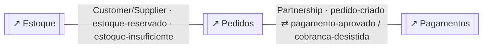
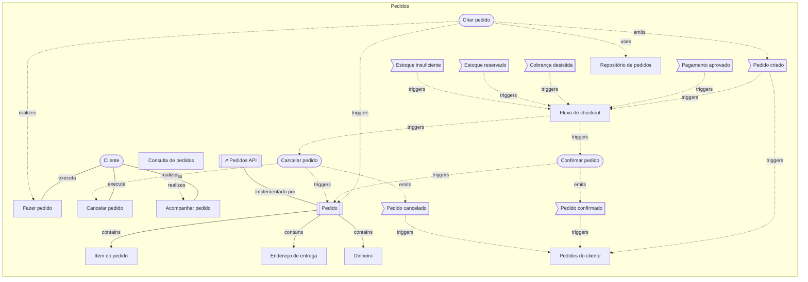
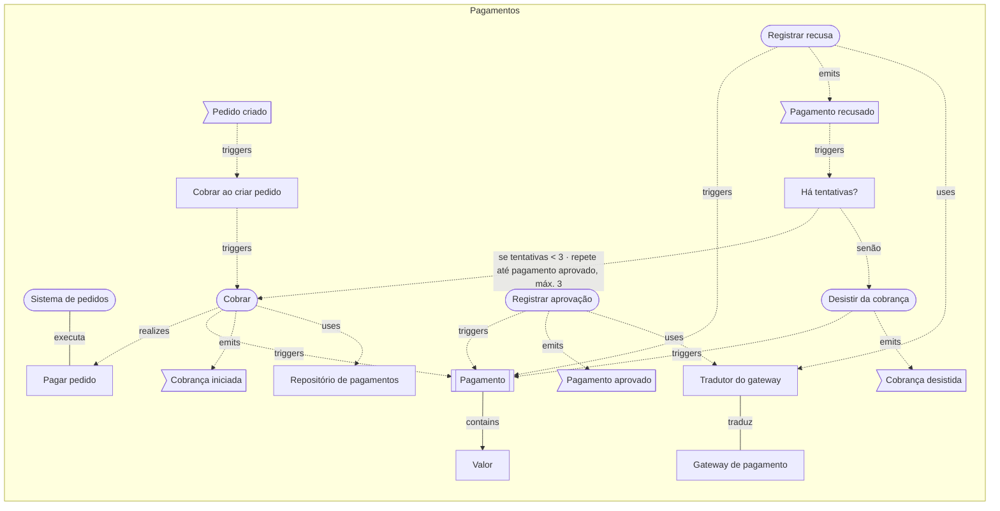
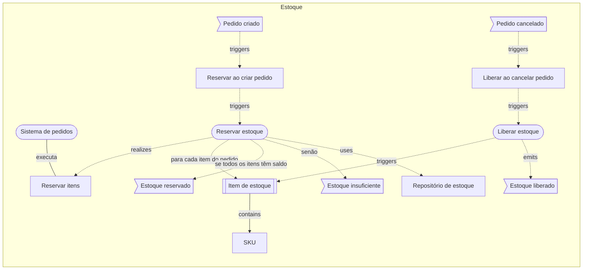
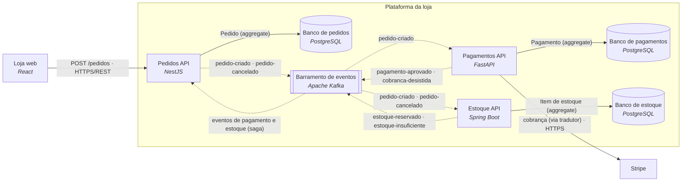

# Loja online: o modelo em texto

> Gerado a partir dos diagramas desta pasta (`npm run examples:build`); é exatamente o que um agente (MCP) recebe em `get_diagram` e `domain_overview`. Não edite à mão.

# Visão geral do projeto

> 4 diagrama(s) de domínio · 3 contexto(s) · 1 visão(ões) geral(is)

## Mapa de contextos
_exemplos-ddd/loja/visao-geral.archflow.json_
- Pedidos —partnership→ Pagamentos via pedido-criado ⇄ pagamento-aprovado / cobranca-desistida
- Estoque —customer-supplier→ Pedidos via estoque-reservado · estoque-insuficiente

## Contextos
- **Estoque** `estoque` (supporting) — `exemplos-ddd/loja/estoque.archflow.json`
  - aggregates: 1 · commands: 2 · eventos publicados: estoque-reservado, estoque-insuficiente, estoque-liberado · consumidos: pedidos.pedido-criado, pedidos.pedido-cancelado
- **Pagamentos** `pagamentos` (generic) — `exemplos-ddd/loja/pagamentos.archflow.json`
  - aggregates: 1 · commands: 4 · eventos publicados: cobranca-iniciada, pagamento-aprovado, pagamento-recusado, cobranca-desistida · consumidos: pedidos.pedido-criado
- **Pedidos** `pedidos` (core) — `exemplos-ddd/loja/pedidos.archflow.json`
  - aggregates: 1 · commands: 3 · eventos publicados: pedido-criado, pedido-confirmado, pedido-cancelado · consumidos: pagamentos.pagamento-aprovado, pagamentos.cobranca-desistida, estoque.estoque-reservado, estoque.estoque-insuficiente

## Casos de uso
- 5 de 5 rastreados até um evento (100%)
- ✔ `reservar-itens-uc` Reservar itens (exemplos-ddd/loja/estoque.archflow.json)
- ✔ `pagar-pedido-uc` Pagar pedido (exemplos-ddd/loja/pagamentos.archflow.json)
- ✔ `fazer-pedido-uc` Fazer pedido (exemplos-ddd/loja/pedidos.archflow.json)
- ✔ `cancelar-pedido-uc` Cancelar pedido (exemplos-ddd/loja/pedidos.archflow.json)
- ✔ `acompanhar-uc` Acompanhar pedido (exemplos-ddd/loja/pedidos.archflow.json)

## Avisos
- [D011 dica] contexto `estoque` (Estoque) sem ligação com a arquitetura: adicione um componente "system" com ref para o diagrama de arquitetura — `exemplos-ddd/loja/estoque.archflow.json`
- [D011 dica] contexto `pagamentos` (Pagamentos) sem ligação com a arquitetura: adicione um componente "system" com ref para o diagrama de arquitetura — `exemplos-ddd/loja/pagamentos.archflow.json`
- [D030 dica] `ha-tentativas` (Há tentativas?) → `cobrar` (Cobrar) está marcada como loop, mas o diagrama não mostra o caminho de volta (de cobrar até ha-tentativas); se o retorno passa por um sistema externo está certo, senão revise a conexão — `exemplos-ddd/loja/pagamentos.archflow.json`

---

<!-- exemplos-ddd/loja/visao-geral.archflow.json -->
# Visão geral — domínio

Loja online: mapa de contextos. Três contextos que conversam por eventos: uma saga coordena pagamento e estoque, o gateway de pagamento fica atrás de uma camada anticorrupção e o diagrama de arquitetura mostra onde cada contexto roda.

> schema archflow/1 · modo domain · 0 contexto(s) · 0 aggregate(s) · 0 caso(s) de uso

## Fora de qualquer contexto

## Relações entre contextos
- `pedidos` —partnership→ `pagamentos` via pedido-criado ⇄ pagamento-aprovado / cobranca-desistida — Dois contextos evoluem juntos e coordenam entregas.
- `estoque` —customer-supplier→ `pedidos` via estoque-reservado · estoque-insuficiente — Fornecedor (upstream) atende o cliente (downstream), que influencia o plano.

## Diagramas referenciados
- `pedidos` **Pedidos** → `exemplos-ddd/loja/pedidos.archflow.json`
- `pagamentos` **Pagamentos** → `exemplos-ddd/loja/pagamentos.archflow.json`
- `estoque` **Estoque** → `exemplos-ddd/loja/estoque.archflow.json`

## Mermaid

---

<!-- exemplos-ddd/loja/pedidos.archflow.json -->
# Pedidos — domínio

> schema archflow/1 · modo domain · 1 contexto(s) · 1 aggregate(s) · 3 caso(s) de uso

## Contexto `pedidos` (core) — Pedidos
O que o cliente comprou e em que estado está o pedido. É onde a loja se diferencia: a experiência de comprar.
_Diferencial competitivo do negócio; onde vale investir no melhor modelo._

### Aggregate `pedido` (root: Pedido)
- entity: `item-do-pedido`
- value-object: `endereco-de-entrega`, `dinheiro`
- invariantes: o total é a soma dos itens; pedido confirmado não aceita novos itens; pedido cancelado não volta a ser confirmado
- propriedades de `pedido`: id: uuid #, clienteId: uuid, status: texto, total: Dinheiro, criadoEm: data e hora, motivoCancelamento?: texto
- propriedades de `item-do-pedido`: produtoId: uuid #, quantidade: inteiro, precoUnitario: Dinheiro
- propriedades de `endereco-de-entrega`: logradouro: texto, numero: texto, complemento?: texto, cidade: texto, cep: texto
- propriedades de `dinheiro`: valor: inteiro, moeda: texto
- command `criar-pedido` — registrar o pedido com os itens e o endereço (parâmetros: clienteId: uuid, itens: Item do pedido[], endereco: Endereço de entrega)
- command `confirmar-pedido` — pagamento e estoque deram certo
- command `cancelar-pedido` — encerrar o pedido (a pedido do cliente ou por falha)
- evento `pedido-criado` (payload: pedidoId: uuid #, itens: Item do pedido[], total: Dinheiro)
- evento `pedido-confirmado` (payload: pedidoId)
- evento `pedido-cancelado` (payload: pedidoId, motivo)
- repository `pedido-repo`

### Process managers (sagas)
- `fluxo-de-checkout` **Fluxo de checkout**: reage a pedido-criado, pagamento-aprovado, cobranca-desistida, estoque-reservado, estoque-insuficiente → dispara confirmar-pedido, cancelar-pedido · compensa com cancelar-pedido

### Application services
- `consulta-de-pedidos` **Consulta de pedidos** — responde "como está meu pedido?" lendo a projeção

### Read models
- `pedidos-do-cliente` **Pedidos do cliente** projeta pedido-criado, pedido-confirmado, pedido-cancelado

### Eventos consumidos de outros contextos
- `pagamento-aprovado` ← pagamentos.pagamento-aprovado
- `cobranca-desistida` ← pagamentos.cobranca-desistida
- `estoque-reservado` ← estoque.estoque-reservado
- `estoque-insuficiente` ← estoque.estoque-insuficiente

## Casos de uso e rastreio
- `fazer-pedido-uc` Fazer pedido (ator: Cliente) → criar-pedido → pedido → pedido-criado ✔
- `cancelar-pedido-uc` Cancelar pedido (ator: Cliente) → cancelar-pedido → pedido → pedido-cancelado ✔
- `acompanhar-uc` Acompanhar pedido (ator: Cliente) → consulta-de-pedidos ✔

## Diagramas referenciados
- `pedidos-api` **Pedidos API** → `exemplos-ddd/loja/arquitetura.archflow.json` (componente `pedidos-api`)

## Mermaid

---

<!-- exemplos-ddd/loja/pagamentos.archflow.json -->
# Pagamentos — domínio

> schema archflow/1 · modo domain · 1 contexto(s) · 1 aggregate(s) · 1 caso(s) de uso

## Contexto `pagamentos` (generic) — Pagamentos
Cobrar e saber se o dinheiro entrou. É um problema comum de mercado: o modelo é simples e o esforço vai para a integração com o gateway.
_Problema comum e resolvido no mercado (auth, e-mail, pagamento); prefira comprar ou usar pronto._

### Aggregate `pagamento` (root: Pagamento)
- value-object: `valor`
- invariantes: valor maior que zero; um pagamento só é aprovado ou recusado uma vez; no máximo 3 tentativas de cobrança por pedido
- command `cobrar` — iniciar a cobrança no gateway
- command `registrar-aprovacao` — o gateway confirmou o pagamento
- command `registrar-recusa` — o gateway recusou o pagamento
- command `desistir-da-cobranca` — encerrar a cobrança depois da última recusa
- evento `cobranca-iniciada` (payload: pedidoId, pagamentoId)
- evento `pagamento-aprovado` (payload: pedidoId, pagamentoId)
- evento `pagamento-recusado` (payload: pedidoId, pagamentoId, motivo)
- evento `cobranca-desistida` (payload: pedidoId, pagamentoId, motivo)
- repository `pagamento-repo`

### Policies
- `cobrar-ao-criar-pedido` **Cobrar ao criar pedido** reage a pedido-criado → dispara cobrar — todo pedido criado gera uma cobrança
- `ha-tentativas` **Há tentativas?** — ainda há tentativas de cobrança para este pedido? → se tentativas < 3 · repete até pagamento aprovado, máx. 3: `cobrar` ↻; senão: `desistir-da-cobranca`

### Domain services
- `tradutor-do-gateway` **Tradutor do gateway** — converte o vocabulário do gateway no nosso

### Eventos consumidos de outros contextos
- `pedido-criado` ← pedidos.pedido-criado

## Casos de uso e rastreio
- `pagar-pedido-uc` Pagar pedido (ator: Sistema de pedidos) → cobrar → pagamento → cobranca-iniciada ✔

## Fluxo condicional, loops e iterações
- `ha-tentativas` —[se tentativas < 3 · repete até pagamento aprovado, máx. 3]→ `cobrar` (volta a um passo anterior)
- `ha-tentativas` —[senão]→ `desistir-da-cobranca`

## Avisos
- [D011 dica] contexto `pagamentos` (Pagamentos) sem ligação com a arquitetura: adicione um componente "system" com ref para o diagrama de arquitetura
- [D030 dica] `ha-tentativas` (Há tentativas?) → `cobrar` (Cobrar) está marcada como loop, mas o diagrama não mostra o caminho de volta (de cobrar até ha-tentativas); se o retorno passa por um sistema externo está certo, senão revise a conexão

## Mermaid

---

<!-- exemplos-ddd/loja/estoque.archflow.json -->
# Estoque — domínio

> schema archflow/1 · modo domain · 1 contexto(s) · 1 aggregate(s) · 1 caso(s) de uso

## Contexto `estoque` (supporting) — Estoque
Quanto temos de cada produto e o que já está reservado.
_Necessário ao negócio, mas sem diferencial; costuma ser feito sob medida e simples._

### Aggregate `item-de-estoque` (root: Item de estoque)
Um aggregate por produto (SKU): reservar o pedido inteiro mexe em vários, e é a saga quem cuida da consistência entre eles.
- value-object: `sku`
- invariantes: a quantidade disponível nunca fica negativa
- command `reservar-estoque` — separar a quantidade pedida de cada item
- command `liberar-estoque` — devolver as reservas de um pedido
- evento `estoque-reservado` (payload: pedidoId)
- evento `estoque-insuficiente` (payload: pedidoId, sku)
- evento `estoque-liberado` (payload: pedidoId)
- repository `item-de-estoque-repo`

### Policies
- `reservar-ao-criar-pedido` **Reservar ao criar pedido** reage a pedido-criado → dispara reservar-estoque — pedido criado reserva os itens
- `liberar-ao-cancelar-pedido` **Liberar ao cancelar pedido** reage a pedido-cancelado → dispara liberar-estoque — pedido cancelado devolve as reservas (compensação da saga)

### Eventos consumidos de outros contextos
- `pedido-criado` ← pedidos.pedido-criado
- `pedido-cancelado` ← pedidos.pedido-cancelado

## Casos de uso e rastreio
- `reservar-itens-uc` Reservar itens (ator: Sistema de pedidos) → reservar-estoque → item-de-estoque → estoque-reservado | reservar-estoque → item-de-estoque → estoque-insuficiente ✔

## Fluxo condicional, loops e iterações
- `reservar-estoque` —[para cada item do pedido]→ `item-de-estoque`
- `reservar-estoque` —[se todos os itens têm saldo]→ `estoque-reservado`
- `reservar-estoque` —[senão]→ `estoque-insuficiente`

## Avisos
- [D011 dica] contexto `estoque` (Estoque) sem ligação com a arquitetura: adicione um componente "system" com ref para o diagrama de arquitetura

## Mermaid

---

<!-- exemplos-ddd/loja/arquitetura.archflow.json -->
# Arquitetura

Como os bounded contexts da loja são implementados: um serviço por contexto, cada um com o seu banco, conversando por eventos.

> schema archflow/1 · 9 componentes · 1 grupos · 11 conexões

## Grupos
- `plataforma` **Plataforma da loja** (boundary: Fronteira de sistema / container)

## Componentes
- `loja-web` **Loja web** · [client] · tecnologia: React — Vitrine e checkout
  - papel da tecnologia: UI declarativa por componentes.
- `pedidos-api` **Pedidos API** · [service] · tecnologia: NestJS · em `plataforma` — Implementa o bounded context Pedidos (aggregate Pedido, saga de checkout)
  - papel da tecnologia: Estrutura modular e injeção de dependência para Node.
- `pedidos-db` **Banco de pedidos** · [database] · tecnologia: PostgreSQL · em `plataforma`
  - papel da tecnologia: Relacional ACID com JSONB, extensões e consultas avançadas.
- `pagamentos-api` **Pagamentos API** · [service] · tecnologia: FastAPI · em `plataforma` — Implementa o bounded context Pagamentos (inclui o tradutor do gateway)
  - papel da tecnologia: APIs Python rápidas com validação e OpenAPI automáticos.
- `pagamentos-db` **Banco de pagamentos** · [database] · tecnologia: PostgreSQL · em `plataforma`
  - papel da tecnologia: Relacional ACID com JSONB, extensões e consultas avançadas.
- `estoque-api` **Estoque API** · [service] · tecnologia: Spring Boot · em `plataforma` — Implementa o bounded context Estoque
  - papel da tecnologia: Microsserviços Java com configuração mínima.
- `estoque-db` **Banco de estoque** · [database] · tecnologia: PostgreSQL · em `plataforma`
  - papel da tecnologia: Relacional ACID com JSONB, extensões e consultas avançadas.
- `eventos` **Barramento de eventos** · [queue] · tecnologia: Apache Kafka · em `plataforma` — Os eventos de domínio viajam aqui: pedido-criado, pagamento-aprovado, estoque-reservado…
  - papel da tecnologia: Log de eventos distribuído para streaming e event sourcing.
- `stripe` **Stripe** · [external]
  - papel da tecnologia: Pagamentos e assinaturas via API.

## Conexões
- `loja-web` (Loja web) **—sync→** `pedidos-api` (Pedidos API) : "POST /pedidos" · protocolo HTTPS/REST
  - semântica: Chamada request/response bloqueante (HTTP/REST, gRPC, GraphQL, RPC). Origem espera a resposta.
- `pedidos-api` (Pedidos API) **—data→** `pedidos-db` (Banco de pedidos) : "Pedido (aggregate)"
  - semântica: Leitura/escrita em banco, cache ou storage (SQL, query, get/put).
- `pagamentos-api` (Pagamentos API) **—data→** `pagamentos-db` (Banco de pagamentos) : "Pagamento (aggregate)"
  - semântica: Leitura/escrita em banco, cache ou storage (SQL, query, get/put).
- `estoque-api` (Estoque API) **—data→** `estoque-db` (Banco de estoque) : "Item de estoque (aggregate)"
  - semântica: Leitura/escrita em banco, cache ou storage (SQL, query, get/put).
- `pedidos-api` (Pedidos API) **—async→** `eventos` (Barramento de eventos) : "pedido-criado · pedido-cancelado"
  - semântica: Mensagem/evento fire-and-forget via fila ou broker (pub/sub, SQS, Kafka, webhooks). Origem não espera.
- `eventos` (Barramento de eventos) **—async→** `pagamentos-api` (Pagamentos API) : "pedido-criado"
  - semântica: Mensagem/evento fire-and-forget via fila ou broker (pub/sub, SQS, Kafka, webhooks). Origem não espera.
- `eventos` (Barramento de eventos) **—async→** `estoque-api` (Estoque API) : "pedido-criado · pedido-cancelado"
  - semântica: Mensagem/evento fire-and-forget via fila ou broker (pub/sub, SQS, Kafka, webhooks). Origem não espera.
- `pagamentos-api` (Pagamentos API) **—async→** `eventos` (Barramento de eventos) : "pagamento-aprovado · cobranca-desistida"
  - semântica: Mensagem/evento fire-and-forget via fila ou broker (pub/sub, SQS, Kafka, webhooks). Origem não espera.
- `estoque-api` (Estoque API) **—async→** `eventos` (Barramento de eventos) : "estoque-reservado · estoque-insuficiente"
  - semântica: Mensagem/evento fire-and-forget via fila ou broker (pub/sub, SQS, Kafka, webhooks). Origem não espera.
- `eventos` (Barramento de eventos) **—async→** `pedidos-api` (Pedidos API) : "eventos de pagamento e estoque (saga)"
  - semântica: Mensagem/evento fire-and-forget via fila ou broker (pub/sub, SQS, Kafka, webhooks). Origem não espera.
- `pagamentos-api` (Pagamentos API) **—sync→** `stripe` (Stripe) : "cobrança (via tradutor)" · protocolo HTTPS
  - semântica: Chamada request/response bloqueante (HTTP/REST, gRPC, GraphQL, RPC). Origem espera a resposta.

## Mermaid

