# Engine de precificação (modo logic)

Para cada produto do grupo, o fluxo escolhe o preço de partida pelo tipo do grupo e passa por onze regras em ordem; cada uma pode reescrever o preço da anterior. Desvios são decisões sim/não, o grupo é um laço e um tipo desconhecido termina em erro. Cada regra e decisão tem exemplos que o app executa, e os cenários rodam o fluxo inteiro.

## Dados

| Nome nas expressões | Dado | Tipo | Valor fixo | Significado |
|---|---|---|---|---|
| `grupo` | Produtos do grupo | lista |  | Os produtos do grupo, da maior receita de 1 mês para a menor (empate: maior custo). O primeiro é a referência. |
| `tipo_grupo` | Tipo do grupo | texto |  | Estratégia do produto: "lucro", "imagem" ou "trafego". |
| `custo` | Custo | dinheiro |  | Custo do produto. |
| `margem_objetivo` | Margem objetivo | percentual |  | Margem objetivo da categoria (herdada da árvore divisão → departamento → categoria). |
| `preco_concorrente` | Preço do concorrente | dinheiro |  | Preço de referência do concorrente (mínimo, médio ou máximo, conforme a configuração). |
| `indice_notabilidade` | Índice da notabilidade | número |  | Multiplica o preço do concorrente em imagem e tráfego. |
| `margem_minima` | Margem mínima | percentual |  | Margem mínima da notabilidade (piso de imagem e tráfego). |
| `preco_atual` | Preço atual | dinheiro |  | Preço praticado hoje. |
| `variacao_minima` | Variação mínima | percentual | `0.02` | Diferença abaixo da qual o preço atual é mantido. |
| `aumento_maximo` | Aumento máximo | percentual | `0.2` | Teto de aumento sobre o preço atual. |
| `reducao_maxima` | Redução máxima | percentual | `0.2` | Piso de redução sobre o preço atual. |
| `grupo_remarcacao` | Grupo de remarcação | lógico |  | O produto está num grupo de remarcação (vale o menor PMC). |
| `pmc` | Menor PMC do grupo | dinheiro |  | Menor preço máximo ao consumidor do grupo de remarcação (0 = sem PMC). |
| `ancora` | Âncora no preço atual | lógico |  | PBM, farmácia popular ou marca própria. |
| `eh_referencia` | É a referência do grupo | lógico |  | Primeiro do grupo no cluster. |
| `preco_referencia_grupo` | Preço da referência do grupo | dinheiro |  | Preço final já calculado da referência do grupo. |
| `preco_fixo` | Preço fixo | dinheiro |  | Preço fixo cadastrado; vale quando maior que zero. |
| `reaplicar_ajustes` | Reaplicar ajustes | lógico | `false` | Restaura o preço digitado gravado, sem propagar de novo. |
| `preco_digitado` | Preço digitado | dinheiro | `0` | Preço digitado pelo usuário e gravado. |
| `preco` | Preço | dinheiro |  | O preço que o fluxo vai calculando: cada regra pode reescrevê-lo. |
| `recomendacao` | Recomendação | texto |  | Resultado: "keep", "raise" ou "reduce". |
| `alerta_pendente` | Alerta pendente | lógico |  | Há alerta pendente quando o preço muda. |

## Fluxo (setas entre os passos)

- **Start** `inicio` — Calcular preços do grupo: Entra o grupo de produtos de um cluster, com as configurações de margem, variação e PMC.
  - → segue: Para cada produto do grupo (`para-cada-produto`)
- **Loop** `para-cada-produto` — Para cada produto do grupo: Da maior receita para a menor; o primeiro é a referência. · para cada produto em produtos do grupo
  - → repete: Carregar o produto (`carregar`)
  - → segue: Decisão de preço pronta (`fim`)
- **Rule** `carregar` — Carregar o produto: Copia os dados do produto da vez e solta qualquer trava do produto anterior.
  - → segue: O custo é válido? (`custo-valido`)
- **Decision** `custo-valido` — O custo é válido?: Sem um custo positivo não há como calcular o preço. custo é maior que 0
  - → sim: A margem objetivo é válida? (`margem-valida`)
  - → não: Dados do produto inválidos (`dados-invalidos`)
- **Decision** `margem-valida` — A margem objetivo é válida?: A margem fica entre 0% e 100%: com 100% ou mais, custo ÷ (1 − margem) perde o sentido. margem objetivo é maior ou igual a 0 e margem objetivo é menor que 1
  - → sim: Qual o tipo do grupo? (`tipo-do-grupo`)
  - → não: Dados do produto inválidos (`dados-invalidos`)
- **Switch** `tipo-do-grupo` — Qual o tipo do grupo?: Lucro parte do custo; imagem e tráfego partem do concorrente. conforme tipo do grupo
  - → = "lucro": Partida: custo e margem (`partida-lucro`)
  - → = "imagem": Partida: concorrente × índice (`partida-concorrente`)
  - → = "trafego": Partida: concorrente × índice (`partida-concorrente`)
  - → outros: Tipo de grupo desconhecido (`grupo-desconhecido`)
- **Rule** `partida-lucro` — Partida: custo e margem: Lucro: custo ÷ (1 − margem objetivo da categoria).
  - → segue: O preço de partida deu zero? (`partida-zerou`)
- **Decision** `partida-zerou` — O preço de partida deu zero?: Se o produto der zero, fica o preço atual. preço é menor ou igual a 0
  - → sim: Manter o preço atual (`manter-atual`)
  - → não: Imagem ou tráfego abaixo do piso? (`abaixo-do-piso`)
- **Rule** `manter-atual` — Manter o preço atual: Sem preço de partida, fica o preço atual.
  - → segue: Imagem ou tráfego abaixo do piso? (`abaixo-do-piso`)
- **Decision** `abaixo-do-piso` — Imagem ou tráfego abaixo do piso?: Margem mínima: só imagem e tráfego; lucro não passa aqui. tipo do grupo está em ["imagem", "trafego"] e preço é menor que custo dividido por (1 menos margem mínima)
  - → sim: Subir até o piso (`subir-ao-piso`)
  - → não: A diferença é menor que a mínima? (`diferenca-pequena`)
- **Rule** `subir-ao-piso` — Subir até o piso: O piso é custo ÷ (1 − margem mínima da notabilidade).
  - → segue: A diferença é menor que a mínima? (`diferenca-pequena`)
- **Decision** `diferenca-pequena` — A diferença é menor que a mínima?: Diferença menor que o mínimo configurado mantém o preço atual. preço atual é maior que 0 e o valor de preço dividido por preço atual menos 1 sem sinal é menor que variação mínima
  - → sim: Manter o preço atual (`manter-por-variacao`)
  - → não: Já existe preço atual? (`tem-preco-atual`)
- **Rule** `manter-por-variacao` — Manter o preço atual: A diferença é pequena demais para valer a troca.
  - → segue: O preço mudou? (`preco-mudou`)
- **Decision** `preco-mudou` — O preço mudou?: O arredondamento só vale quando o preço mudou. preço é diferente de preço atual
  - → sim: Em que faixa está o preço? (`faixa-do-preco`)
  - → não: Passou do PMC do grupo? (`passou-do-pmc`)
- **Switch** `faixa-do-preco` — Em que faixa está o preço?: Arredondamento por faixa: vale a primeira que se encaixar, de cima para baixo. (a primeira condição que valer)
  - → = preco < 0.1: Abaixo de R$ 0,10 (`faixa-minima`)
  - → = preco > 202.01: Acima de R$ 202,01 (`faixa-alta`)
  - → = entre(preco, 200, 202): De R$ 200 a R$ 202 (`faixa-200`)
  - → = entre(preco, 100, 101): De R$ 100 a R$ 101 (`faixa-100`)
  - → = preco < 10: Até R$ 10 (`faixa-ate-10`)
  - → = preco < 50 e preco - piso(preco) >= 0.5: Até R$ 50, com 50 centavos ou mais (`faixa-ate-50-cima`)
  - → = preco < 50: Até R$ 50, com menos de 50 centavos (`faixa-ate-50-baixo`)
  - → outros: Acima disso (`faixa-resto`)
- **Rule** `faixa-minima` — Abaixo de R$ 0,10: Vira R$ 0,09.
  - → segue: Passou do PMC do grupo? (`passou-do-pmc`)
- **Decision** `passou-do-pmc` — Passou do PMC do grupo?: No grupo de remarcação vale o menor PMC. grupo de remarcação e menor pmc do grupo é maior que 0 e preço é maior que menor pmc do grupo
  - → sim: Descer para o PMC (`descer-ao-pmc`)
  - → não: Imagem ou tráfego que segue a referência? (`segue-a-referencia`)
- **Rule** `descer-ao-pmc` — Descer para o PMC: Desce um centavo além do último dígito de centavo do PMC.
  - → segue: Imagem ou tráfego que segue a referência? (`segue-a-referencia`)
- **Decision** `segue-a-referencia` — Imagem ou tráfego que segue a referência?: A referência é o primeiro do grupo; PBM, farmácia popular e marca própria ancoram no preço atual. tipo do grupo está em ["imagem", "trafego"] e não (é a referência do grupo) e não (âncora no preço atual)
  - → sim: Igualar à referência (`igualar-referencia`)
  - → não: É PBM, popular ou marca própria? (`e-ancora`)
- **Rule** `igualar-referencia` — Igualar à referência: Os demais do grupo igualam o preço da referência.
  - → segue: É PBM, popular ou marca própria? (`e-ancora`)
- **Decision** `e-ancora` — É PBM, popular ou marca própria?: Esses produtos ficam no preço atual. âncora no preço atual
  - → sim: Voltar ao preço atual e travar (`ancorar`)
  - → não: Existe preço fixo? (`tem-preco-fixo`)
- **Rule** `ancorar` — Voltar ao preço atual e travar: O preço volta ao atual e as regras seguintes não o reescrevem.
  - → segue: Existe preço fixo? (`tem-preco-fixo`)
- **Decision** `tem-preco-fixo` — Existe preço fixo?: Se for maior que zero, vence tudo o que veio antes. preço fixo é maior que 0
  - → sim: Aplicar o preço fixo (`aplicar-preco-fixo`)
  - → não: Lucro que não é a referência? (`segue-referencia-lucro`)
- **Rule** `aplicar-preco-fixo` — Aplicar o preço fixo: Vence tudo o que veio antes, inclusive a trava da âncora.
  - → segue: Lucro que não é a referência? (`segue-referencia-lucro`)
- **Decision** `segue-referencia-lucro` — Lucro que não é a referência?: A referência é a de maior receita no grupo; quem já ficou travado não é reescrito. tipo do grupo é igual a "lucro" e não (é a referência do grupo)
  - → sim: Igualar à referência (`igualar-referencia-lucro`)
  - → não: Recomendar (`recomendar`)
- **Rule** `igualar-referencia-lucro` — Igualar à referência: Quem já ficou travado na âncora ou no preço fixo não é reescrito (a trava impede).
  - → segue: Recomendar (`recomendar`)
- **Rule** `recomendar` — Recomendar: Keep se os preços coincidem nos centavos; senão raise ou reduce. O alerta fica pendente quando o preço muda.
  - → segue: Reaplicar ajustes gravados? (`reaplicar-ajustes`)
- **Decision** `reaplicar-ajustes` — Reaplicar ajustes gravados?: Depois do cálculo, restaura o preço digitado, sem propagar de novo. reaplicar ajustes e preço digitado é maior que 0
  - → sim: Restaurar o preço digitado (`restaurar-digitado`)
  - → não: É a referência do grupo? (`e-a-referencia`)
- **Rule** `restaurar-digitado` — Restaurar o preço digitado: Volta o preço que o usuário digitou.
  - → segue: É a referência do grupo? (`e-a-referencia`)
- **Decision** `e-a-referencia` — É a referência do grupo?: A referência guarda o preço final para os demais seguirem. é a referência do grupo
  - → sim: Guardar o preço da referência (`guardar-referencia`)
  - → não: Para cada produto do grupo (`para-cada-produto`)
- **Rule** `guardar-referencia` — Guardar o preço da referência: Os próximos produtos do grupo usam este preço.
  - → segue: Para cada produto do grupo (`para-cada-produto`)
- **Rule** `faixa-alta` — Acima de R$ 202,01: Vai ao inteiro anterior menos um centavo.
  - → segue: Passou do PMC do grupo? (`passou-do-pmc`)
- **Rule** `faixa-200` — De R$ 200 a R$ 202: Vira R$ 199,99.
  - → segue: Passou do PMC do grupo? (`passou-do-pmc`)
- **Rule** `faixa-100` — De R$ 100 a R$ 101: Vira R$ 99,99.
  - → segue: Passou do PMC do grupo? (`passou-do-pmc`)
- **Rule** `faixa-ate-10` — Até R$ 10: Termina em 9.
  - → segue: Passou do PMC do grupo? (`passou-do-pmc`)
- **Rule** `faixa-ate-50-cima` — Até R$ 50, com 50 centavos ou mais: Termina em 49.
  - → segue: Passou do PMC do grupo? (`passou-do-pmc`)
- **Rule** `faixa-ate-50-baixo` — Até R$ 50, com menos de 50 centavos: Termina em 99, do real anterior.
  - → segue: Passou do PMC do grupo? (`passou-do-pmc`)
- **Rule** `faixa-resto` — Acima disso: Termina em 99.
  - → segue: Passou do PMC do grupo? (`passou-do-pmc`)
- **Decision** `tem-preco-atual` — Já existe preço atual?: Sem preço atual não há o que comparar nem cortar. preço atual é maior que 0
  - → sim: Cortar no teto e no piso (`cortar-variacao`)
  - → não: O preço mudou? (`preco-mudou`)
- **Rule** `cortar-variacao` — Cortar no teto e no piso: Aumento ou redução acima do máximo é cortado no teto ou no piso.
  - → segue: O preço mudou? (`preco-mudou`)
- **Rule** `partida-concorrente` — Partida: concorrente × índice: Imagem e tráfego: preço do concorrente × índice da notabilidade.
  - → segue: O preço de partida deu zero? (`partida-zerou`)
- **End** `grupo-desconhecido` — Tipo de grupo desconhecido: [erro] Não há como partir o preço: a engine para e avisa.
- **End** `dados-invalidos` — Dados do produto inválidos: [erro] O produto tem um dado que impede o cálculo: o fluxo para e avisa.
- **End** `fim` — Decisão de preço pronta: Cada produto sai com preço, recomendação (keep, raise, reduce) e alerta.

## Regras (o que cada uma faz)

### Carregar o produto (carregar)
Copia os dados do produto da vez e solta qualquer trava do produto anterior.
- **Quando:** sempre
- **Então:** `destravar preco` — libera preço: volta a poder ser reescrito
- **Então:** `tipo_grupo := produto.tipo_grupo` — tipo do grupo passa a ser produto.tipo_grupo
- **Então:** `custo := produto.custo` — custo passa a ser produto.custo
- **Então:** `margem_objetivo := produto.margem_objetivo` — margem objetivo passa a ser produto.margem_objetivo
- **Então:** `preco_concorrente := produto.preco_concorrente` — preço do concorrente passa a ser produto.preco_concorrente
- **Então:** `indice_notabilidade := produto.indice_notabilidade` — índice da notabilidade passa a ser produto.indice_notabilidade
- **Então:** `margem_minima := produto.margem_minima` — margem mínima passa a ser produto.margem_minima
- **Então:** `preco_atual := produto.preco_atual` — preço atual passa a ser produto.preco_atual
- **Então:** `grupo_remarcacao := produto.grupo_remarcacao` — grupo de remarcação passa a ser produto.grupo_remarcacao
- **Então:** `pmc := produto.pmc` — menor pmc do grupo passa a ser produto.pmc
- **Então:** `ancora := produto.ancora` — âncora no preço atual passa a ser produto.ancora
- **Então:** `eh_referencia := produto.eh_referencia` — é a referência do grupo passa a ser produto.eh_referencia
- **Então:** `preco_fixo := produto.preco_fixo` — preço fixo passa a ser produto.preco_fixo
- ✔ exemplo "copia os dados"

### Partida: custo e margem (partida-lucro)
Lucro: custo ÷ (1 − margem objetivo da categoria).
- **Quando:** sempre
- **Então:** `preco := custo / (1 - margem_objetivo)` — preço passa a ser custo dividido por (1 menos margem objetivo)
- ✔ exemplo "custo 60, margem 40%"

### Partida: concorrente × índice (partida-concorrente)
Imagem e tráfego: preço do concorrente × índice da notabilidade.
- **Quando:** sempre
- **Então:** `preco := preco_concorrente * indice_notabilidade` — preço passa a ser preço do concorrente vezes índice da notabilidade
- ✔ exemplo "80 × 0,95"

### Manter o preço atual (manter-atual)
Sem preço de partida, fica o preço atual.
- **Quando:** sempre
- **Então:** `preco := preco_atual` — preço passa a ser preço atual
- ✔ exemplo "volta ao atual"

### Subir até o piso (subir-ao-piso)
O piso é custo ÷ (1 − margem mínima da notabilidade).
- **Quando:** sempre
- **Então:** `preco := custo / (1 - margem_minima)` — preço passa a ser custo dividido por (1 menos margem mínima)
- ✔ exemplo "sobe ao piso"

### Manter o preço atual (manter-por-variacao)
A diferença é pequena demais para valer a troca.
- **Quando:** sempre
- **Então:** `preco := preco_atual` — preço passa a ser preço atual
- ✔ exemplo "mantém"

### Cortar no teto e no piso (cortar-variacao)
Aumento ou redução acima do máximo é cortado no teto ou no piso.
- **Quando:** sempre
- **Então:** `preco := min(preco, preco_atual * (1 + aumento_maximo))` — preço passa a ser o menor entre preço, preço atual vezes (1 mais aumento máximo)
- **Então:** `preco := max(preco, preco_atual * (1 - reducao_maxima))` — preço passa a ser o maior entre preço, preço atual vezes (1 menos redução máxima)
- ✔ exemplo "aumento cortado"
- ✔ exemplo "redução cortada"

### Abaixo de R$ 0,10 (faixa-minima)
Vira R$ 0,09.
- **Quando:** sempre
- **Então:** `preco := 0.09` — preço passa a ser 0,09
- ✔ exemplo "0,05"

### Acima de R$ 202,01 (faixa-alta)
Vai ao inteiro anterior menos um centavo.
- **Quando:** sempre
- **Então:** `preco := piso(preco) - 0.01` — preço passa a ser preço arredondado para baixo menos 0,01
- ✔ exemplo "250,40"

### De R$ 200 a R$ 202 (faixa-200)
Vira R$ 199,99.
- **Quando:** sempre
- **Então:** `preco := 199.99` — preço passa a ser 199,99
- ✔ exemplo "201"

### De R$ 100 a R$ 101 (faixa-100)
Vira R$ 99,99.
- **Quando:** sempre
- **Então:** `preco := 99.99` — preço passa a ser 99,99
- ✔ exemplo "100"

### Até R$ 10 (faixa-ate-10)
Termina em 9.
- **Quando:** sempre
- **Então:** `preco := piso(preco * 10) / 10 - 0.01` — preço passa a ser preço vezes 10 arredondado para baixo dividido por 10 menos 0,01
- ✔ exemplo "7,34"

### Até R$ 50, com 50 centavos ou mais (faixa-ate-50-cima)
Termina em 49.
- **Quando:** sempre
- **Então:** `preco := piso(preco) + 0.49` — preço passa a ser preço arredondado para baixo mais 0,49
- ✔ exemplo "23,70"

### Até R$ 50, com menos de 50 centavos (faixa-ate-50-baixo)
Termina em 99, do real anterior.
- **Quando:** sempre
- **Então:** `preco := piso(preco) - 0.01` — preço passa a ser preço arredondado para baixo menos 0,01
- ✔ exemplo "23,20"

### Acima disso (faixa-resto)
Termina em 99.
- **Quando:** sempre
- **Então:** `preco := piso(preco) + 0.99` — preço passa a ser preço arredondado para baixo mais 0,99
- ✔ exemplo "84"

### Descer para o PMC (descer-ao-pmc)
Desce um centavo além do último dígito de centavo do PMC.
A confirmar: "desce um centavo além do último dígito de centavo do PMC" foi entendido como PMC menos R$ 0,01.
- **Quando:** sempre
- **Então:** `preco := pmc - 0.01` — preço passa a ser menor pmc do grupo menos 0,01
- ✔ exemplo "12,34 → 12,33"

### Igualar à referência (igualar-referencia)
Os demais do grupo igualam o preço da referência.
- **Quando:** sempre
- **Então:** `preco := preco_referencia_grupo` — preço passa a ser preço da referência do grupo
- ✔ exemplo "acompanha"

### Voltar ao preço atual e travar (ancorar)
O preço volta ao atual e as regras seguintes não o reescrevem.
- **Quando:** sempre
- **Então:** `preco := preco_atual` — preço passa a ser preço atual
- **Então:** `travar preco` — trava preço: as regras seguintes não o reescrevem
- ✔ exemplo "volta e trava"

### Aplicar o preço fixo (aplicar-preco-fixo)
Vence tudo o que veio antes, inclusive a trava da âncora.
- **Quando:** sempre
- **Então:** `destravar preco` — libera preço: volta a poder ser reescrito
- **Então:** `preco := preco_fixo` — preço passa a ser preço fixo
- **Então:** `travar preco` — trava preço: as regras seguintes não o reescrevem
- ✔ exemplo "vence a âncora"

### Igualar à referência (igualar-referencia-lucro)
Quem já ficou travado na âncora ou no preço fixo não é reescrito (a trava impede).
- **Quando:** sempre
- **Então:** `preco := preco_referencia_grupo` — preço passa a ser preço da referência do grupo
- ✔ exemplo "segue"

### Recomendar (recomendar)
Keep se os preços coincidem nos centavos; senão raise ou reduce. O alerta fica pendente quando o preço muda.
- **Quando:** sempre
- **Então:** `recomendacao := se arredondar(preco, 2) = arredondar(preco_atual, 2) entao "keep" senao (se preco > preco_atual entao "raise" senao "reduce")` — recomendação passa a ser se preço arredondado a 2 casa(s) decimais é igual a preço atual arredondado a 2 casa(s) decimais, então "keep"; senão se preço é maior que preço atual, então "raise"; senão "reduce"
- **Então:** `alerta_pendente := arredondar(preco, 2) != arredondar(preco_atual, 2)` — alerta pendente passa a ser preço arredondado a 2 casa(s) decimais é diferente de preço atual arredondado a 2 casa(s) decimais
- ✔ exemplo "sobe"
- ✔ exemplo "cai"
- ✔ exemplo "igual"

### Restaurar o preço digitado (restaurar-digitado)
Volta o preço que o usuário digitou.
- **Quando:** sempre
- **Então:** `preco := preco_digitado` — preço passa a ser preço digitado
- ✔ exemplo "restaura"

### Guardar o preço da referência (guardar-referencia)
Os próximos produtos do grupo usam este preço.
- **Quando:** sempre
- **Então:** `preco_referencia_grupo := preco` — preço da referência do grupo passa a ser preço
- ✔ exemplo "guarda"

## Decisões e escolhas

- **O custo é válido?** (`custo-valido`): Sem um custo positivo não há como calcular o preço. custo é maior que 0
  - ✔ exemplo "válido"
  - ✔ exemplo "zerado"
- **A margem objetivo é válida?** (`margem-valida`): A margem fica entre 0% e 100%: com 100% ou mais, custo ÷ (1 − margem) perde o sentido. margem objetivo é maior ou igual a 0 e margem objetivo é menor que 1
  - ✔ exemplo "40%"
  - ✔ exemplo "120%"
- **Qual o tipo do grupo?** (`tipo-do-grupo`): Lucro parte do custo; imagem e tráfego partem do concorrente. conforme tipo do grupo
  - ✔ exemplo "lucro"
  - ✔ exemplo "imagem"
  - ✔ exemplo "tipo desconhecido"
- **O preço de partida deu zero?** (`partida-zerou`): Se o produto der zero, fica o preço atual. preço é menor ou igual a 0
  - ✔ exemplo "zero"
  - ✔ exemplo "positivo"
- **Imagem ou tráfego abaixo do piso?** (`abaixo-do-piso`): Margem mínima: só imagem e tráfego; lucro não passa aqui. tipo do grupo está em ["imagem", "trafego"] e preço é menor que custo dividido por (1 menos margem mínima)
  - ✔ exemplo "imagem abaixo"
  - ✔ exemplo "lucro não passa"
- **A diferença é menor que a mínima?** (`diferenca-pequena`): Diferença menor que o mínimo configurado mantém o preço atual. preço atual é maior que 0 e o valor de preço dividido por preço atual menos 1 sem sinal é menor que variação mínima
  - ✔ exemplo "1% < 2%"
  - ✔ exemplo "11% ≥ 2%"
- **Já existe preço atual?** (`tem-preco-atual`): Sem preço atual não há o que comparar nem cortar. preço atual é maior que 0
  - ✔ exemplo "tem"
  - ✔ exemplo "novo produto"
- **O preço mudou?** (`preco-mudou`): O arredondamento só vale quando o preço mudou. preço é diferente de preço atual
  - ✔ exemplo "mudou"
  - ✔ exemplo "igual"
- **Em que faixa está o preço?** (`faixa-do-preco`): Arredondamento por faixa: vale a primeira que se encaixar, de cima para baixo. (a primeira condição que valer)
  - ✔ exemplo "faixa de 100"
  - ✔ exemplo "acima de 202"
  - ✔ exemplo "de 50 a 100"
- **Passou do PMC do grupo?** (`passou-do-pmc`): No grupo de remarcação vale o menor PMC. grupo de remarcação e menor pmc do grupo é maior que 0 e preço é maior que menor pmc do grupo
  - ✔ exemplo "passou"
  - ✔ exemplo "sem PMC"
- **Imagem ou tráfego que segue a referência?** (`segue-a-referencia`): A referência é o primeiro do grupo; PBM, farmácia popular e marca própria ancoram no preço atual. tipo do grupo está em ["imagem", "trafego"] e não (é a referência do grupo) e não (âncora no preço atual)
  - ✔ exemplo "segue"
  - ✔ exemplo "é a referência"
- **É PBM, popular ou marca própria?** (`e-ancora`): Esses produtos ficam no preço atual. âncora no preço atual
  - ✔ exemplo "âncora"
  - ✔ exemplo "comum"
- **Existe preço fixo?** (`tem-preco-fixo`): Se for maior que zero, vence tudo o que veio antes. preço fixo é maior que 0
  - ✔ exemplo "fixo"
  - ✔ exemplo "sem fixo"
- **Lucro que não é a referência?** (`segue-referencia-lucro`): A referência é a de maior receita no grupo; quem já ficou travado não é reescrito. tipo do grupo é igual a "lucro" e não (é a referência do grupo)
  - ✔ exemplo "seguidor"
  - ✔ exemplo "referência"
- **Reaplicar ajustes gravados?** (`reaplicar-ajustes`): Depois do cálculo, restaura o preço digitado, sem propagar de novo. reaplicar ajustes e preço digitado é maior que 0
  - ✔ exemplo "reaplica"
  - ✔ exemplo "não"
- **É a referência do grupo?** (`e-a-referencia`): A referência guarda o preço final para os demais seguirem. é a referência do grupo
  - ✔ exemplo "sim"
  - ✔ exemplo "não"

## Cenários (o fluxo inteiro)

### Lucro: a referência abre e o seguidor acompanha (caso-lucro)
A referência (custo 60) sai em 99,99; o seguidor, que sozinho iria a 64,99, iguala a referência.
- ✔ "lucro" (fim: ok)
  - Loop Para cada produto do grupo: saiu por "repete" (volta 1)
  - Rule Carregar o produto: tipo_grupo sem valor → "lucro", custo sem valor → 60, margem_objetivo sem valor → 0.4, preco_concorrente sem valor → 0, indice_notabilidade sem valor → 1, margem_minima sem valor → 0.3, preco_atual sem valor → 90, grupo_remarcacao sem valor → false, pmc sem valor → 0, ancora sem valor → false, eh_referencia sem valor → true, preco_fixo sem valor → 0
  - Decision O custo é válido?: saiu por "sim"
  - Decision A margem objetivo é válida?: saiu por "sim"
  - Switch Qual o tipo do grupo?: saiu por "lucro"
  - Rule Partida: custo e margem: preco sem valor → 100
  - Decision O preço de partida deu zero?: saiu por "nao"
  - Decision Imagem ou tráfego abaixo do piso?: saiu por "nao"
  - Decision A diferença é menor que a mínima?: saiu por "nao"
  - Decision Já existe preço atual?: saiu por "sim"
  - Rule Cortar no teto e no piso: preco 100 → 100, preco 100 → 100
  - Decision O preço mudou?: saiu por "sim"
  - Switch Em que faixa está o preço?: saiu por "entre(preco, 100, 101)"
  - Rule De R$ 100 a R$ 101: preco 100 → 99.99
  - Decision Passou do PMC do grupo?: saiu por "nao"
  - Decision Imagem ou tráfego que segue a referência?: saiu por "nao"
  - Decision É PBM, popular ou marca própria?: saiu por "nao"
  - Decision Existe preço fixo?: saiu por "nao"
  - Decision Lucro que não é a referência?: saiu por "nao"
  - Rule Recomendar: recomendacao sem valor → "raise", alerta_pendente sem valor → true
  - Decision Reaplicar ajustes gravados?: saiu por "nao"
  - Decision É a referência do grupo?: saiu por "sim"
  - Rule Guardar o preço da referência: preco_referencia_grupo sem valor → 99.99
  - Loop Para cada produto do grupo: saiu por "repete" (volta 2)
  - Rule Carregar o produto: tipo_grupo "lucro" → "lucro", custo 60 → 30, margem_objetivo 0.4 → 0.4, preco_concorrente 0 → 0, indice_notabilidade 1 → 1, margem_minima 0.3 → 0.3, preco_atual 90 → 80, grupo_remarcacao false → false, pmc 0 → 0, ancora false → false, eh_referencia true → false, preco_fixo 0 → 0
  - Decision O custo é válido?: saiu por "sim"
  - Decision A margem objetivo é válida?: saiu por "sim"
  - Switch Qual o tipo do grupo?: saiu por "lucro"
  - Rule Partida: custo e margem: preco 99.99 → 50
  - Decision O preço de partida deu zero?: saiu por "nao"
  - Decision Imagem ou tráfego abaixo do piso?: saiu por "nao"
  - Decision A diferença é menor que a mínima?: saiu por "nao"
  - Decision Já existe preço atual?: saiu por "sim"
  - Rule Cortar no teto e no piso: preco 50 → 50, preco 50 → 64
  - Decision O preço mudou?: saiu por "sim"
  - Switch Em que faixa está o preço?: saiu por "outros"
  - Rule Acima disso: preco 64 → 64.99
  - Decision Passou do PMC do grupo?: saiu por "nao"
  - Decision Imagem ou tráfego que segue a referência?: saiu por "nao"
  - Decision É PBM, popular ou marca própria?: saiu por "nao"
  - Decision Existe preço fixo?: saiu por "nao"
  - Decision Lucro que não é a referência?: saiu por "sim"
  - Rule Igualar à referência: preco 64.99 → 99.99
  - Rule Recomendar: recomendacao "raise" → "raise", alerta_pendente true → true
  - Decision Reaplicar ajustes gravados?: saiu por "nao"
  - Decision É a referência do grupo?: saiu por "nao"
  - Loop Para cada produto do grupo: saiu por "segue"
  - End Decisão de preço pronta

### Marca própria ancora (caso-ancora)
O seguidor é marca própria: volta ao preço atual e a igualação à referência não o reescreve.
- ✔ "ancorado" (fim: ok)
  - Loop Para cada produto do grupo: saiu por "repete" (volta 1)
  - Rule Carregar o produto: tipo_grupo sem valor → "lucro", custo sem valor → 60, margem_objetivo sem valor → 0.4, preco_concorrente sem valor → 0, indice_notabilidade sem valor → 1, margem_minima sem valor → 0.3, preco_atual sem valor → 90, grupo_remarcacao sem valor → false, pmc sem valor → 0, ancora sem valor → false, eh_referencia sem valor → true, preco_fixo sem valor → 0
  - Decision O custo é válido?: saiu por "sim"
  - Decision A margem objetivo é válida?: saiu por "sim"
  - Switch Qual o tipo do grupo?: saiu por "lucro"
  - Rule Partida: custo e margem: preco sem valor → 100
  - Decision O preço de partida deu zero?: saiu por "nao"
  - Decision Imagem ou tráfego abaixo do piso?: saiu por "nao"
  - Decision A diferença é menor que a mínima?: saiu por "nao"
  - Decision Já existe preço atual?: saiu por "sim"
  - Rule Cortar no teto e no piso: preco 100 → 100, preco 100 → 100
  - Decision O preço mudou?: saiu por "sim"
  - Switch Em que faixa está o preço?: saiu por "entre(preco, 100, 101)"
  - Rule De R$ 100 a R$ 101: preco 100 → 99.99
  - Decision Passou do PMC do grupo?: saiu por "nao"
  - Decision Imagem ou tráfego que segue a referência?: saiu por "nao"
  - Decision É PBM, popular ou marca própria?: saiu por "nao"
  - Decision Existe preço fixo?: saiu por "nao"
  - Decision Lucro que não é a referência?: saiu por "nao"
  - Rule Recomendar: recomendacao sem valor → "raise", alerta_pendente sem valor → true
  - Decision Reaplicar ajustes gravados?: saiu por "nao"
  - Decision É a referência do grupo?: saiu por "sim"
  - Rule Guardar o preço da referência: preco_referencia_grupo sem valor → 99.99
  - Loop Para cada produto do grupo: saiu por "repete" (volta 2)
  - Rule Carregar o produto: tipo_grupo "lucro" → "lucro", custo 60 → 60, margem_objetivo 0.4 → 0.4, preco_concorrente 0 → 0, indice_notabilidade 1 → 1, margem_minima 0.3 → 0.3, preco_atual 90 → 85, grupo_remarcacao false → false, pmc 0 → 0, ancora false → true, eh_referencia true → false, preco_fixo 0 → 0
  - Decision O custo é válido?: saiu por "sim"
  - Decision A margem objetivo é válida?: saiu por "sim"
  - Switch Qual o tipo do grupo?: saiu por "lucro"
  - Rule Partida: custo e margem: preco 99.99 → 100
  - Decision O preço de partida deu zero?: saiu por "nao"
  - Decision Imagem ou tráfego abaixo do piso?: saiu por "nao"
  - Decision A diferença é menor que a mínima?: saiu por "nao"
  - Decision Já existe preço atual?: saiu por "sim"
  - Rule Cortar no teto e no piso: preco 100 → 100, preco 100 → 100
  - Decision O preço mudou?: saiu por "sim"
  - Switch Em que faixa está o preço?: saiu por "entre(preco, 100, 101)"
  - Rule De R$ 100 a R$ 101: preco 100 → 99.99
  - Decision Passou do PMC do grupo?: saiu por "nao"
  - Decision Imagem ou tráfego que segue a referência?: saiu por "nao"
  - Decision É PBM, popular ou marca própria?: saiu por "sim"
  - Rule Voltar ao preço atual e travar: preco 99.99 → 85 · trava preco
  - Decision Existe preço fixo?: saiu por "nao"
  - Decision Lucro que não é a referência?: saiu por "sim"
  - Rule Igualar à referência: não reescreve (travado): preco
  - Rule Recomendar: recomendacao "raise" → "keep", alerta_pendente true → false
  - Decision Reaplicar ajustes gravados?: saiu por "nao"
  - Decision É a referência do grupo?: saiu por "nao"
  - Loop Para cada produto do grupo: saiu por "segue"
  - End Decisão de preço pronta

### Preço fixo vence a âncora (caso-fixo)
A âncora travou o preço, mas o preço fixo destrava e vence.
- ✔ "fixo" (fim: ok)
  - Loop Para cada produto do grupo: saiu por "repete" (volta 1)
  - Rule Carregar o produto: tipo_grupo sem valor → "lucro", custo sem valor → 60, margem_objetivo sem valor → 0.4, preco_concorrente sem valor → 0, indice_notabilidade sem valor → 1, margem_minima sem valor → 0.3, preco_atual sem valor → 90, grupo_remarcacao sem valor → false, pmc sem valor → 0, ancora sem valor → false, eh_referencia sem valor → true, preco_fixo sem valor → 0
  - Decision O custo é válido?: saiu por "sim"
  - Decision A margem objetivo é válida?: saiu por "sim"
  - Switch Qual o tipo do grupo?: saiu por "lucro"
  - Rule Partida: custo e margem: preco sem valor → 100
  - Decision O preço de partida deu zero?: saiu por "nao"
  - Decision Imagem ou tráfego abaixo do piso?: saiu por "nao"
  - Decision A diferença é menor que a mínima?: saiu por "nao"
  - Decision Já existe preço atual?: saiu por "sim"
  - Rule Cortar no teto e no piso: preco 100 → 100, preco 100 → 100
  - Decision O preço mudou?: saiu por "sim"
  - Switch Em que faixa está o preço?: saiu por "entre(preco, 100, 101)"
  - Rule De R$ 100 a R$ 101: preco 100 → 99.99
  - Decision Passou do PMC do grupo?: saiu por "nao"
  - Decision Imagem ou tráfego que segue a referência?: saiu por "nao"
  - Decision É PBM, popular ou marca própria?: saiu por "nao"
  - Decision Existe preço fixo?: saiu por "nao"
  - Decision Lucro que não é a referência?: saiu por "nao"
  - Rule Recomendar: recomendacao sem valor → "raise", alerta_pendente sem valor → true
  - Decision Reaplicar ajustes gravados?: saiu por "nao"
  - Decision É a referência do grupo?: saiu por "sim"
  - Rule Guardar o preço da referência: preco_referencia_grupo sem valor → 99.99
  - Loop Para cada produto do grupo: saiu por "repete" (volta 2)
  - Rule Carregar o produto: tipo_grupo "lucro" → "lucro", custo 60 → 60, margem_objetivo 0.4 → 0.4, preco_concorrente 0 → 0, indice_notabilidade 1 → 1, margem_minima 0.3 → 0.3, preco_atual 90 → 85, grupo_remarcacao false → false, pmc 0 → 0, ancora false → true, eh_referencia true → false, preco_fixo 0 → 55
  - Decision O custo é válido?: saiu por "sim"
  - Decision A margem objetivo é válida?: saiu por "sim"
  - Switch Qual o tipo do grupo?: saiu por "lucro"
  - Rule Partida: custo e margem: preco 99.99 → 100
  - Decision O preço de partida deu zero?: saiu por "nao"
  - Decision Imagem ou tráfego abaixo do piso?: saiu por "nao"
  - Decision A diferença é menor que a mínima?: saiu por "nao"
  - Decision Já existe preço atual?: saiu por "sim"
  - Rule Cortar no teto e no piso: preco 100 → 100, preco 100 → 100
  - Decision O preço mudou?: saiu por "sim"
  - Switch Em que faixa está o preço?: saiu por "entre(preco, 100, 101)"
  - Rule De R$ 100 a R$ 101: preco 100 → 99.99
  - Decision Passou do PMC do grupo?: saiu por "nao"
  - Decision Imagem ou tráfego que segue a referência?: saiu por "nao"
  - Decision É PBM, popular ou marca própria?: saiu por "sim"
  - Rule Voltar ao preço atual e travar: preco 99.99 → 85 · trava preco
  - Decision Existe preço fixo?: saiu por "sim"
  - Rule Aplicar o preço fixo: preco 85 → 55 · trava preco
  - Decision Lucro que não é a referência?: saiu por "sim"
  - Rule Igualar à referência: não reescreve (travado): preco
  - Rule Recomendar: recomendacao "raise" → "reduce", alerta_pendente true → true
  - Decision Reaplicar ajustes gravados?: saiu por "nao"
  - Decision É a referência do grupo?: saiu por "nao"
  - Loop Para cada produto do grupo: saiu por "segue"
  - End Decisão de preço pronta

### Imagem acompanha a referência (caso-imagem)
Em imagem, a referência parte do concorrente (76,99); o seguidor iria a 85,99 e iguala a referência.
- ✔ "imagem" (fim: ok)
  - Loop Para cada produto do grupo: saiu por "repete" (volta 1)
  - Rule Carregar o produto: tipo_grupo sem valor → "imagem", custo sem valor → 50, margem_objetivo sem valor → 0.4, preco_concorrente sem valor → 80, indice_notabilidade sem valor → 0.95, margem_minima sem valor → 0.3, preco_atual sem valor → 70, grupo_remarcacao sem valor → false, pmc sem valor → 0, ancora sem valor → false, eh_referencia sem valor → true, preco_fixo sem valor → 0
  - Decision O custo é válido?: saiu por "sim"
  - Decision A margem objetivo é válida?: saiu por "sim"
  - Switch Qual o tipo do grupo?: saiu por "imagem"
  - Rule Partida: concorrente × índice: preco sem valor → 76
  - Decision O preço de partida deu zero?: saiu por "nao"
  - Decision Imagem ou tráfego abaixo do piso?: saiu por "nao"
  - Decision A diferença é menor que a mínima?: saiu por "nao"
  - Decision Já existe preço atual?: saiu por "sim"
  - Rule Cortar no teto e no piso: preco 76 → 76, preco 76 → 76
  - Decision O preço mudou?: saiu por "sim"
  - Switch Em que faixa está o preço?: saiu por "outros"
  - Rule Acima disso: preco 76 → 76.99
  - Decision Passou do PMC do grupo?: saiu por "nao"
  - Decision Imagem ou tráfego que segue a referência?: saiu por "nao"
  - Decision É PBM, popular ou marca própria?: saiu por "nao"
  - Decision Existe preço fixo?: saiu por "nao"
  - Decision Lucro que não é a referência?: saiu por "nao"
  - Rule Recomendar: recomendacao sem valor → "raise", alerta_pendente sem valor → true
  - Decision Reaplicar ajustes gravados?: saiu por "nao"
  - Decision É a referência do grupo?: saiu por "sim"
  - Rule Guardar o preço da referência: preco_referencia_grupo sem valor → 76.99
  - Loop Para cada produto do grupo: saiu por "repete" (volta 2)
  - Rule Carregar o produto: tipo_grupo "imagem" → "imagem", custo 50 → 50, margem_objetivo 0.4 → 0.4, preco_concorrente 80 → 90, indice_notabilidade 0.95 → 0.95, margem_minima 0.3 → 0.3, preco_atual 70 → 75, grupo_remarcacao false → false, pmc 0 → 0, ancora false → false, eh_referencia true → false, preco_fixo 0 → 0
  - Decision O custo é válido?: saiu por "sim"
  - Decision A margem objetivo é válida?: saiu por "sim"
  - Switch Qual o tipo do grupo?: saiu por "imagem"
  - Rule Partida: concorrente × índice: preco 76.99 → 85.5
  - Decision O preço de partida deu zero?: saiu por "nao"
  - Decision Imagem ou tráfego abaixo do piso?: saiu por "nao"
  - Decision A diferença é menor que a mínima?: saiu por "nao"
  - Decision Já existe preço atual?: saiu por "sim"
  - Rule Cortar no teto e no piso: preco 85.5 → 85.5, preco 85.5 → 85.5
  - Decision O preço mudou?: saiu por "sim"
  - Switch Em que faixa está o preço?: saiu por "outros"
  - Rule Acima disso: preco 85.5 → 85.99
  - Decision Passou do PMC do grupo?: saiu por "nao"
  - Decision Imagem ou tráfego que segue a referência?: saiu por "sim"
  - Rule Igualar à referência: preco 85.99 → 76.99
  - Decision É PBM, popular ou marca própria?: saiu por "nao"
  - Decision Existe preço fixo?: saiu por "nao"
  - Decision Lucro que não é a referência?: saiu por "nao"
  - Rule Recomendar: recomendacao "raise" → "raise", alerta_pendente true → true
  - Decision Reaplicar ajustes gravados?: saiu por "nao"
  - Decision É a referência do grupo?: saiu por "nao"
  - Loop Para cada produto do grupo: saiu por "segue"
  - End Decisão de preço pronta

### Diferença pequena (caso-variacao-minima)
O novo preço difere menos que o mínimo: fica o preço atual, sem alerta.
- ✔ "mantém" (fim: ok)
  - Loop Para cada produto do grupo: saiu por "repete" (volta 1)
  - Rule Carregar o produto: tipo_grupo sem valor → "lucro", custo sem valor → 60, margem_objetivo sem valor → 0.4, preco_concorrente sem valor → 0, indice_notabilidade sem valor → 1, margem_minima sem valor → 0.3, preco_atual sem valor → 99, grupo_remarcacao sem valor → false, pmc sem valor → 0, ancora sem valor → false, eh_referencia sem valor → true, preco_fixo sem valor → 0
  - Decision O custo é válido?: saiu por "sim"
  - Decision A margem objetivo é válida?: saiu por "sim"
  - Switch Qual o tipo do grupo?: saiu por "lucro"
  - Rule Partida: custo e margem: preco sem valor → 100
  - Decision O preço de partida deu zero?: saiu por "nao"
  - Decision Imagem ou tráfego abaixo do piso?: saiu por "nao"
  - Decision A diferença é menor que a mínima?: saiu por "sim"
  - Rule Manter o preço atual: preco 100 → 99
  - Decision O preço mudou?: saiu por "nao"
  - Decision Passou do PMC do grupo?: saiu por "nao"
  - Decision Imagem ou tráfego que segue a referência?: saiu por "nao"
  - Decision É PBM, popular ou marca própria?: saiu por "nao"
  - Decision Existe preço fixo?: saiu por "nao"
  - Decision Lucro que não é a referência?: saiu por "nao"
  - Rule Recomendar: recomendacao sem valor → "keep", alerta_pendente sem valor → false
  - Decision Reaplicar ajustes gravados?: saiu por "nao"
  - Decision É a referência do grupo?: saiu por "sim"
  - Rule Guardar o preço da referência: preco_referencia_grupo sem valor → 99
  - Loop Para cada produto do grupo: saiu por "segue"
  - End Decisão de preço pronta

### Aumento cortado no teto (caso-teto)
A partida pede +43%, mas o teto é +20%: sobe até 84 e arredonda para 84,99.
- ✔ "teto de 20%" (fim: ok)
  - Loop Para cada produto do grupo: saiu por "repete" (volta 1)
  - Rule Carregar o produto: tipo_grupo sem valor → "lucro", custo sem valor → 60, margem_objetivo sem valor → 0.4, preco_concorrente sem valor → 0, indice_notabilidade sem valor → 1, margem_minima sem valor → 0.3, preco_atual sem valor → 70, grupo_remarcacao sem valor → false, pmc sem valor → 0, ancora sem valor → false, eh_referencia sem valor → true, preco_fixo sem valor → 0
  - Decision O custo é válido?: saiu por "sim"
  - Decision A margem objetivo é válida?: saiu por "sim"
  - Switch Qual o tipo do grupo?: saiu por "lucro"
  - Rule Partida: custo e margem: preco sem valor → 100
  - Decision O preço de partida deu zero?: saiu por "nao"
  - Decision Imagem ou tráfego abaixo do piso?: saiu por "nao"
  - Decision A diferença é menor que a mínima?: saiu por "nao"
  - Decision Já existe preço atual?: saiu por "sim"
  - Rule Cortar no teto e no piso: preco 100 → 84, preco 84 → 84
  - Decision O preço mudou?: saiu por "sim"
  - Switch Em que faixa está o preço?: saiu por "outros"
  - Rule Acima disso: preco 84 → 84.99
  - Decision Passou do PMC do grupo?: saiu por "nao"
  - Decision Imagem ou tráfego que segue a referência?: saiu por "nao"
  - Decision É PBM, popular ou marca própria?: saiu por "nao"
  - Decision Existe preço fixo?: saiu por "nao"
  - Decision Lucro que não é a referência?: saiu por "nao"
  - Rule Recomendar: recomendacao sem valor → "raise", alerta_pendente sem valor → true
  - Decision Reaplicar ajustes gravados?: saiu por "nao"
  - Decision É a referência do grupo?: saiu por "sim"
  - Rule Guardar o preço da referência: preco_referencia_grupo sem valor → 84.99
  - Loop Para cada produto do grupo: saiu por "segue"
  - End Decisão de preço pronta

### Remarcação passa do PMC (caso-pmc)
Calculou 12,50, arredondou para 12,49 e o PMC de 12,34 puxa para 12,33.
- ✔ "PMC" (fim: ok)
  - Loop Para cada produto do grupo: saiu por "repete" (volta 1)
  - Rule Carregar o produto: tipo_grupo sem valor → "lucro", custo sem valor → 10, margem_objetivo sem valor → 0.2, preco_concorrente sem valor → 0, indice_notabilidade sem valor → 1, margem_minima sem valor → 0.3, preco_atual sem valor → 12, grupo_remarcacao sem valor → true, pmc sem valor → 12.34, ancora sem valor → false, eh_referencia sem valor → true, preco_fixo sem valor → 0
  - Decision O custo é válido?: saiu por "sim"
  - Decision A margem objetivo é válida?: saiu por "sim"
  - Switch Qual o tipo do grupo?: saiu por "lucro"
  - Rule Partida: custo e margem: preco sem valor → 12.5
  - Decision O preço de partida deu zero?: saiu por "nao"
  - Decision Imagem ou tráfego abaixo do piso?: saiu por "nao"
  - Decision A diferença é menor que a mínima?: saiu por "nao"
  - Decision Já existe preço atual?: saiu por "sim"
  - Rule Cortar no teto e no piso: preco 12.5 → 12.5, preco 12.5 → 12.5
  - Decision O preço mudou?: saiu por "sim"
  - Switch Em que faixa está o preço?: saiu por "preco < 50 e preco - piso(preco) >= 0.5"
  - Rule Até R$ 50, com 50 centavos ou mais: preco 12.5 → 12.49
  - Decision Passou do PMC do grupo?: saiu por "sim"
  - Rule Descer para o PMC: preco 12.49 → 12.33
  - Decision Imagem ou tráfego que segue a referência?: saiu por "nao"
  - Decision É PBM, popular ou marca própria?: saiu por "nao"
  - Decision Existe preço fixo?: saiu por "nao"
  - Decision Lucro que não é a referência?: saiu por "nao"
  - Rule Recomendar: recomendacao sem valor → "raise", alerta_pendente sem valor → true
  - Decision Reaplicar ajustes gravados?: saiu por "nao"
  - Decision É a referência do grupo?: saiu por "sim"
  - Rule Guardar o preço da referência: preco_referencia_grupo sem valor → 12.33
  - Loop Para cada produto do grupo: saiu por "segue"
  - End Decisão de preço pronta

### Tipo de grupo desconhecido (caso-erro)
Um tipo que a engine não conhece termina em erro, sem calcular nada.
- ✔ "erro" (fim: erro)
  - Loop Para cada produto do grupo: saiu por "repete" (volta 1)
  - Rule Carregar o produto: tipo_grupo sem valor → "outro", custo sem valor → 60, margem_objetivo sem valor → 0.4, preco_concorrente sem valor → 0, indice_notabilidade sem valor → 1, margem_minima sem valor → 0.3, preco_atual sem valor → 90, grupo_remarcacao sem valor → false, pmc sem valor → 0, ancora sem valor → false, eh_referencia sem valor → true, preco_fixo sem valor → 0
  - Decision O custo é válido?: saiu por "sim"
  - Decision A margem objetivo é válida?: saiu por "sim"
  - Switch Qual o tipo do grupo?: saiu por "outros"
  - End Tipo de grupo desconhecido

### Custo zerado interrompe o cálculo (caso-custo-invalido)
Sem custo positivo o fluxo para no primeiro produto, com erro.
- ✔ "custo zerado" (fim: erro)
  - Loop Para cada produto do grupo: saiu por "repete" (volta 1)
  - Rule Carregar o produto: tipo_grupo sem valor → "lucro", custo sem valor → 0, margem_objetivo sem valor → 0.4, preco_concorrente sem valor → 0, indice_notabilidade sem valor → 1, margem_minima sem valor → 0.3, preco_atual sem valor → 90, grupo_remarcacao sem valor → false, pmc sem valor → 0, ancora sem valor → false, eh_referencia sem valor → true, preco_fixo sem valor → 0
  - Decision O custo é válido?: saiu por "nao"
  - End Dados do produto inválidos

### Margem de 100% ou mais é recusada (caso-margem-invalida)
Uma margem objetivo fora de 0% a 100% termina em erro antes de calcular o preço.
- ✔ "margem de 120%" (fim: erro)
  - Loop Para cada produto do grupo: saiu por "repete" (volta 1)
  - Rule Carregar o produto: tipo_grupo sem valor → "lucro", custo sem valor → 60, margem_objetivo sem valor → 1.2, preco_concorrente sem valor → 0, indice_notabilidade sem valor → 1, margem_minima sem valor → 0.3, preco_atual sem valor → 90, grupo_remarcacao sem valor → false, pmc sem valor → 0, ancora sem valor → false, eh_referencia sem valor → true, preco_fixo sem valor → 0
  - Decision O custo é válido?: saiu por "sim"
  - Decision A margem objetivo é válida?: saiu por "nao"
  - End Dados do produto inválidos

### Um produto inválido para o grupo no meio (caso-falha-no-meio)
A referência já foi calculada (99,99); o segundo produto tem custo negativo e o fluxo termina em erro.
- ✔ "falha no segundo" (fim: erro)
  - Loop Para cada produto do grupo: saiu por "repete" (volta 1)
  - Rule Carregar o produto: tipo_grupo sem valor → "lucro", custo sem valor → 60, margem_objetivo sem valor → 0.4, preco_concorrente sem valor → 0, indice_notabilidade sem valor → 1, margem_minima sem valor → 0.3, preco_atual sem valor → 90, grupo_remarcacao sem valor → false, pmc sem valor → 0, ancora sem valor → false, eh_referencia sem valor → true, preco_fixo sem valor → 0
  - Decision O custo é válido?: saiu por "sim"
  - Decision A margem objetivo é válida?: saiu por "sim"
  - Switch Qual o tipo do grupo?: saiu por "lucro"
  - Rule Partida: custo e margem: preco sem valor → 100
  - Decision O preço de partida deu zero?: saiu por "nao"
  - Decision Imagem ou tráfego abaixo do piso?: saiu por "nao"
  - Decision A diferença é menor que a mínima?: saiu por "nao"
  - Decision Já existe preço atual?: saiu por "sim"
  - Rule Cortar no teto e no piso: preco 100 → 100, preco 100 → 100
  - Decision O preço mudou?: saiu por "sim"
  - Switch Em que faixa está o preço?: saiu por "entre(preco, 100, 101)"
  - Rule De R$ 100 a R$ 101: preco 100 → 99.99
  - Decision Passou do PMC do grupo?: saiu por "nao"
  - Decision Imagem ou tráfego que segue a referência?: saiu por "nao"
  - Decision É PBM, popular ou marca própria?: saiu por "nao"
  - Decision Existe preço fixo?: saiu por "nao"
  - Decision Lucro que não é a referência?: saiu por "nao"
  - Rule Recomendar: recomendacao sem valor → "raise", alerta_pendente sem valor → true
  - Decision Reaplicar ajustes gravados?: saiu por "nao"
  - Decision É a referência do grupo?: saiu por "sim"
  - Rule Guardar o preço da referência: preco_referencia_grupo sem valor → 99.99
  - Loop Para cada produto do grupo: saiu por "repete" (volta 2)
  - Rule Carregar o produto: tipo_grupo "lucro" → "lucro", custo 60 → -5, margem_objetivo 0.4 → 0.4, preco_concorrente 0 → 0, indice_notabilidade 1 → 1, margem_minima 0.3 → 0.3, preco_atual 90 → 90, grupo_remarcacao false → false, pmc 0 → 0, ancora false → false, eh_referencia true → false, preco_fixo 0 → 0
  - Decision O custo é válido?: saiu por "nao"
  - End Dados do produto inválidos

### Grupo sem produtos (caso-grupo-vazio)
Sem produtos, o laço não repete nenhuma vez e o fluxo termina bem, sem calcular nada.
- ✔ "vazio" (fim: ok)
  - Loop Para cada produto do grupo: saiu por "segue"
  - End Decisão de preço pronta

## Avisos

Nenhum.

## Mermaid

```mermaid
flowchart LR
  subgraph n_entradas["Dados de entrada"]
    n_grupo["Produtos do grupo"]
    n_tipo_grupo["Tipo do grupo"]
    n_custo["Custo"]
    n_margem_objetivo["Margem objetivo"]
    n_preco_concorrente["Preço do concorrente"]
    n_indice_notabilidade["Índice da notabilidade"]
    n_margem_minima["Margem mínima"]
    n_preco_atual["Preço atual"]
    n_variacao_minima["Variação mínima"]
    n_aumento_maximo["Aumento máximo"]
    n_reducao_maxima["Redução máxima"]
    n_grupo_remarcacao["Grupo de remarcação"]
    n_pmc["Menor PMC do grupo"]
    n_ancora["Âncora no preço atual"]
    n_eh_referencia["É a referência do grupo"]
    n_preco_referencia_grupo["Preço da referência do grupo"]
    n_preco_fixo["Preço fixo"]
    n_reaplicar["Reaplicar ajustes"]
    n_preco_digitado["Preço digitado"]
  end
  subgraph n_resultados["Resultados"]
    n_preco["Preço"]
    n_recomendacao["Recomendação"]
    n_alerta["Alerta pendente"]
  end
  subgraph n_cenarios["Cenários que dão certo"]
    n_caso_lucro["Lucro: a referência abre e o seguidor acompanha"]
    n_caso_ancora["Marca própria ancora"]
    n_caso_fixo["Preço fixo vence a âncora"]
    n_caso_imagem["Imagem acompanha a referência"]
    n_caso_variacao_minima["Diferença pequena"]
    n_caso_teto["Aumento cortado no teto"]
    n_caso_pmc["Remarcação passa do PMC"]
    n_caso_grupo_vazio["Grupo sem produtos"]
  end
  subgraph n_cenarios_falha["Cenários que falham"]
    n_caso_erro["Tipo de grupo desconhecido"]
    n_caso_custo_invalido["Custo zerado interrompe o cálculo"]
    n_caso_margem_invalida["Margem de 100% ou mais é recusada"]
    n_caso_falha_no_meio["Um produto inválido para o grupo no meio"]
  end
  n_inicio["Calcular preços do grupo"]
  n_para_cada_produto["Para cada produto do grupo"]
  n_carregar["Carregar o produto"]
  n_custo_valido["O custo é válido?"]
  n_margem_valida["A margem objetivo é válida?"]
  n_dados_invalidos["Dados do produto inválidos"]
  n_tipo_do_grupo["Qual o tipo do grupo?"]
  n_partida_lucro["Partida: custo e margem"]
  n_partida_concorrente["Partida: concorrente × índice"]
  n_grupo_desconhecido["Tipo de grupo desconhecido"]
  n_partida_zerou["O preço de partida deu zero?"]
  n_manter_atual["Manter o preço atual"]
  n_abaixo_do_piso["Imagem ou tráfego abaixo do piso?"]
  n_subir_ao_piso["Subir até o piso"]
  n_diferenca_pequena["A diferença é menor que a mínima?"]
  n_manter_por_variacao["Manter o preço atual"]
  n_tem_preco_atual["Já existe preço atual?"]
  n_cortar_variacao["Cortar no teto e no piso"]
  n_preco_mudou["O preço mudou?"]
  n_faixa_do_preco["Em que faixa está o preço?"]
  n_faixa_minima["Abaixo de R$ 0,10"]
  n_faixa_alta["Acima de R$ 202,01"]
  n_faixa_200["De R$ 200 a R$ 202"]
  n_faixa_100["De R$ 100 a R$ 101"]
  n_faixa_ate_10["Até R$ 10"]
  n_faixa_ate_50_cima["Até R$ 50, com 50 centavos ou mais"]
  n_faixa_ate_50_baixo["Até R$ 50, com menos de 50 centavos"]
  n_faixa_resto["Acima disso"]
  n_passou_do_pmc["Passou do PMC do grupo?"]
  n_descer_ao_pmc["Descer para o PMC"]
  n_segue_a_referencia["Imagem ou tráfego que segue a referência?"]
  n_igualar_referencia["Igualar à referência"]
  n_e_ancora["É PBM, popular ou marca própria?"]
  n_ancorar["Voltar ao preço atual e travar"]
  n_tem_preco_fixo["Existe preço fixo?"]
  n_aplicar_preco_fixo["Aplicar o preço fixo"]
  n_segue_referencia_lucro["Lucro que não é a referência?"]
  n_igualar_referencia_lucro["Igualar à referência"]
  n_recomendar["Recomendar"]
  n_reaplicar_ajustes["Reaplicar ajustes gravados?"]
  n_restaurar_digitado["Restaurar o preço digitado"]
  n_e_a_referencia["É a referência do grupo?"]
  n_guardar_referencia["Guardar o preço da referência"]
  n_fim["Decisão de preço pronta"]
  n_inicio -->|"Acesso a dados"| n_para_cada_produto
  n_para_cada_produto -->|"repete"| n_carregar
  n_carregar -->|"Acesso a dados"| n_custo_valido
  n_custo_valido -->|"sim"| n_margem_valida
  n_custo_valido -->|"não"| n_dados_invalidos
  n_margem_valida -->|"sim"| n_tipo_do_grupo
  n_margem_valida -->|"não"| n_dados_invalidos
  n_tipo_do_grupo -->|"= 'lucro'"| n_partida_lucro
  n_tipo_do_grupo -->|"= 'imagem'"| n_partida_concorrente
  n_tipo_do_grupo -->|"= 'trafego'"| n_partida_concorrente
  n_tipo_do_grupo -->|"outros"| n_grupo_desconhecido
  n_partida_lucro -->|"Acesso a dados"| n_partida_zerou
  n_partida_concorrente -->|"Acesso a dados"| n_partida_zerou
  n_partida_zerou -->|"sim"| n_manter_atual
  n_partida_zerou -->|"não"| n_abaixo_do_piso
  n_manter_atual -->|"Acesso a dados"| n_abaixo_do_piso
  n_abaixo_do_piso -->|"sim"| n_subir_ao_piso
  n_abaixo_do_piso -->|"não"| n_diferenca_pequena
  n_subir_ao_piso -->|"Acesso a dados"| n_diferenca_pequena
  n_diferenca_pequena -->|"sim"| n_manter_por_variacao
  n_diferenca_pequena -->|"não"| n_tem_preco_atual
  n_manter_por_variacao -->|"Acesso a dados"| n_preco_mudou
  n_tem_preco_atual -->|"sim"| n_cortar_variacao
  n_tem_preco_atual -->|"não"| n_preco_mudou
  n_cortar_variacao -->|"Acesso a dados"| n_preco_mudou
  n_preco_mudou -->|"sim"| n_faixa_do_preco
  n_preco_mudou -->|"não"| n_passou_do_pmc
  n_faixa_do_preco -->|"preço < 0,1"| n_faixa_minima
  n_faixa_do_preco -->|"preço > 202,01"| n_faixa_alta
  n_faixa_do_preco -->|"preço está entre 200 e 202"| n_faixa_200
  n_faixa_do_preco -->|"preço está entre 100 e 101"| n_faixa_100
  n_faixa_do_preco -->|"preço < 10"| n_faixa_ate_10
  n_faixa_do_preco -->|"preço < 50 e preço − piso(preço) …"| n_faixa_ate_50_cima
  n_faixa_do_preco -->|"preço < 50"| n_faixa_ate_50_baixo
  n_faixa_do_preco -->|"outros"| n_faixa_resto
  n_faixa_minima -->|"Acesso a dados"| n_passou_do_pmc
  n_faixa_alta -->|"Acesso a dados"| n_passou_do_pmc
  n_faixa_200 -->|"Acesso a dados"| n_passou_do_pmc
  n_faixa_100 -->|"Acesso a dados"| n_passou_do_pmc
  n_faixa_ate_10 -->|"Acesso a dados"| n_passou_do_pmc
  n_faixa_ate_50_cima -->|"Acesso a dados"| n_passou_do_pmc
  n_faixa_ate_50_baixo -->|"Acesso a dados"| n_passou_do_pmc
  n_faixa_resto -->|"Acesso a dados"| n_passou_do_pmc
  n_passou_do_pmc -->|"sim"| n_descer_ao_pmc
  n_passou_do_pmc -->|"não"| n_segue_a_referencia
  n_descer_ao_pmc -->|"Acesso a dados"| n_segue_a_referencia
  n_segue_a_referencia -->|"sim"| n_igualar_referencia
  n_segue_a_referencia -->|"não"| n_e_ancora
  n_igualar_referencia -->|"Acesso a dados"| n_e_ancora
  n_e_ancora -->|"sim"| n_ancorar
  n_e_ancora -->|"não"| n_tem_preco_fixo
  n_ancorar -->|"Acesso a dados"| n_tem_preco_fixo
  n_tem_preco_fixo -->|"sim"| n_aplicar_preco_fixo
  n_tem_preco_fixo -->|"não"| n_segue_referencia_lucro
  n_aplicar_preco_fixo -->|"Acesso a dados"| n_segue_referencia_lucro
  n_segue_referencia_lucro -->|"sim"| n_igualar_referencia_lucro
  n_segue_referencia_lucro -->|"não"| n_recomendar
  n_igualar_referencia_lucro -->|"Acesso a dados"| n_recomendar
  n_recomendar -->|"Acesso a dados"| n_reaplicar_ajustes
  n_reaplicar_ajustes -->|"sim"| n_restaurar_digitado
  n_reaplicar_ajustes -->|"não"| n_e_a_referencia
  n_restaurar_digitado -->|"Acesso a dados"| n_e_a_referencia
  n_e_a_referencia -->|"sim"| n_guardar_referencia
  n_e_a_referencia -->|"não"| n_para_cada_produto
  n_guardar_referencia -->|"Acesso a dados"| n_para_cada_produto
  n_para_cada_produto -->|"segue"| n_fim
```

